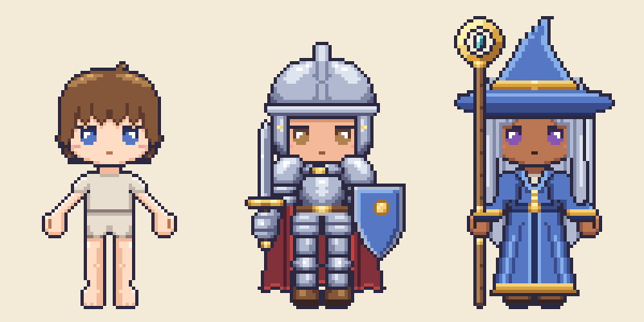
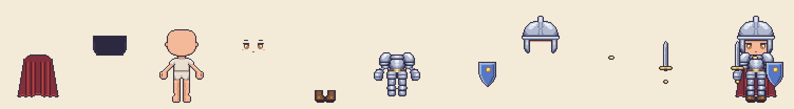
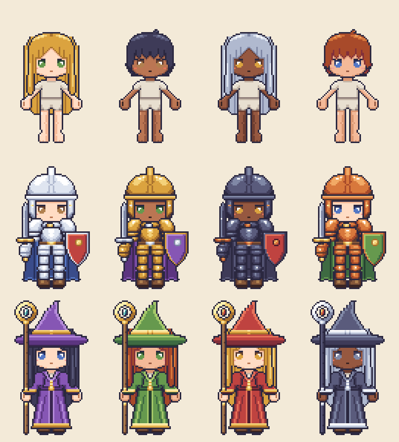

# งานศิลป์: sprite ซ้อนชั้น

ตัวละครทุกตัวประกอบจากชิ้นที่วาดครั้งเดียวบน canvas 64×96 เท่ากันทุกชิ้น แล้วเปลี่ยนสีด้วย palette ตอนประกอบ ภาพด้านล่างคือภาพตั้งต้น 3 ภาพที่รอ Phupha อนุมัติ ทุกภาพประกอบจากไฟล์ใน `src/` จริง ไม่มีภาพไหนวาดทั้งตัว



นักรบแยกเป็นชั้น จากหลังไปหน้า แล้วตามด้วยภาพรวม (ผมด้านหน้าไม่ขึ้นเพราะหมวกสั่งซ่อน)



ชิ้นชุดเดิมทั้งหมด เปลี่ยนแค่สีผิว ผม ตา และวัสดุ



## ดูภาพหลังแก้ไฟล์

```sh
node art/tools/preview.mjs
```

ใช้ Node 18 ขึ้นไป ไม่ต้องติดตั้งอะไรเพิ่ม script ตรวจทุกไฟล์ใน `src/` ก่อน ถ้าแถวยาวไม่ครบหรือมีตัวอักษรแปลกจะบอกชื่อไฟล์และเลขแถว แล้วเขียนภาพใหม่ลง `preview/` ห้ามแก้ภาพใน `preview/` ด้วยมือ

## โฟลเดอร์

| ที่อยู่ | คืออะไร |
| --- | --- |
| `palette.json` | 48 สีของทั้งเกม และชุดสี (ramp) ของผิว ผม ตา และวัสดุ |
| `src/<ช่อง>/<ทรง>.txt` | ตารางพิกเซลทีละชิ้น ชิ้นที่มีส่วนหน้าและส่วนหลังแยกเป็น `<ทรง>.front.txt` กับ `<ทรง>.back.txt` |
| `anchors.json` | สูตรประกอบภาพตั้งต้นและชุดสลับสี |
| `tools/pixelmap.mjs` | อ่านไฟล์ เปลี่ยนสี ซ้อนชั้น เขียน PNG |
| `tools/preview.mjs` | สร้างภาพใน `preview/` |

ช่องที่มีตอนนี้: `body` `face` `hair` `cloak` `feet` `torso` `offhand` `head` `mainhand` ชื่อไฟล์คือทรงของชิ้น ไม่ใช่วัสดุ เช่น `torso/plate.txt` เป็นเกราะแผ่น จะเป็นเหล็ก ทอง หรือเหล็กรมดำก็ไฟล์เดียวกัน

## รูปแบบไฟล์

```text
# เกราะแผ่นเต็มตัว            ← คอมเมนต์
layer: torso                  ← ชั้นที่ชิ้นนี้อยู่ (ดูตารางลำดับชั้น)
hides: hair_front             ← ชั้นที่ต้องซ่อนเมื่อใส่ชิ้นนี้ (ไม่ใส่ก็ได้)
m1: iron                      ← วัสดุตั้งต้นของช่องสี m1 m2 m3 (สูตรประกอบเปลี่ยนได้)
---
................................................................   ← 96 แถว แถวละ 64 ตัว
```

หนึ่งตัวอักษรคือหนึ่งพิกเซล ทุกไฟล์ใช้ตำแหน่งเดียวกับร่างฐาน จึงไม่ต้องตั้งพิกัดทีละชิ้น

## สีกุญแจ

| ตัวอักษร | สี | มาจาก |
| --- | --- | --- |
| `.` | โปร่งใส | |
| `o` | เส้นขอบ #2b2840 สีเดียวกับรูปต้นแบบ | คงที่ |
| `w` | ขาว จุดสะท้อนแสง | คงที่ |
| `q r s t` | ผิว เข้มสุด เงา กลาง สว่าง (`q` ใช้กับปากและเส้นนิ้ว) | ตัวละคร |
| `p` | แก้มแดง | ตัวละคร |
| `g h i j` | ผม เข้ม กลาง สว่าง ประกาย | ตัวละคร |
| `e f` | ตา เข้ม สว่าง | ตัวละคร |
| `a b c d` | วัสดุ 1 จากเข้มไปสว่าง | ชิ้นของ |
| `k l m n` | วัสดุ 2 จากเข้มไปสว่าง | ชิ้นของ |
| `u v x y` | วัสดุ 3 จากเข้มไปสว่าง | ชิ้นของ |

สีผิว ผม และตาเป็นของตัวละคร ใช้ร่วมกันทุกชิ้น ชิ้นของจึงวาดผิวได้ด้วย เช่น เงาใต้กระบังหมวกใช้ `r` แล้วจะเป็นสีผิวของคนที่สวมเสมอ ส่วน `m1 m2 m3` เป็นของแต่ละชิ้น ชิ้นหนึ่งจึงมีได้สามวัสดุ เช่น โล่ใช้ m1 เป็นสีหน้าโล่ m2 เป็นขอบเหล็ก m3 เป็นปุ่มทองเหลือง

## ลำดับชั้น จากหลังไปหน้า

| # | ชั้น | ชื่อใน `layer:` |
| --- | --- | --- |
| 1 | ผ้าคลุม ชิ้นหลัง | `cloak_back` |
| 2 | หาง ปีก | `race_back` |
| 3 | ผมด้านหลัง | `hair_back` |
| 4 | ร่างฐานและสีผิว | `body` |
| 5 | หน้า: ตา ปาก คิ้ว | `face` |
| 6 | รองเท้า | `feet` |
| 7 | ชุดลำตัวหรือเกราะ | `torso` |
| 8 | มือรอง | `offhand` |
| 9 | หู เขา เครา | `race_front` |
| 10 | ผมด้านหน้า | `hair_front` |
| 11 | หมวก | `head` |
| 12 | ผ้าคลุม ชิ้นหน้า | `cloak_front` |
| 13 | อาวุธหลัก | `mainhand` |
| 14 | แสงตามระดับของ | สร้างด้วยโค้ด ไม่มีไฟล์ |

## ตำแหน่งบนร่างฐาน

พิกัดนับจากมุมซ้ายบน (x, y) เริ่มที่ 0 ซ้ายและขวาในตารางคือซ้ายขวาของคนดู

| ส่วน | x | y |
| --- | --- | --- |
| หัว (ผิว ไม่รวมผม) | 18–45 | 24–49 |
| ผมสูงสุด | 16–47 | 19 |
| ตา | 22–27 และ 36–41 | 37–42 |
| ปาก | 31–32 | 45 |
| ไหล่ | 20–43 | 51–57 |
| กำปั้นขวาของตัวละคร (ซ้ายจอ) | 11–18 | 64–71 |
| กำปั้นซ้ายของตัวละคร (ขวาจอ) | 45–52 | 64–71 |
| ขา | 24–30 และ 33–39 | 72–87 |
| เท้า | 23–30 และ 33–40 | 88–93 |

สัดส่วน 1:2.5 หัวพร้อมผมสูงราว 30 แถว ทั้งตัวราว 75 แถว พื้นที่เหนือหัว 19 แถวไว้ให้หมวกสูงและไม้เท้า

## กติกาการวาด

- เส้นขอบนอกใช้ `o` ทุกชิ้น เส้นด้านในใช้เฉดเข้มสุดของวัสดุนั้น เช่น ปลายหน้าม้าที่ทับหน้าใช้ `g` ไม่ใช้ `o`
- เงา 2 ถึง 3 ระดับต่อวัสดุ ไม่ใช้ dithering ตามรูปต้นแบบ
- ชิ้นที่คลุมร่างกายต้องใหญ่กว่าร่างฐานอย่างน้อยเท่าเส้นขอบ ไม่งั้นเส้นขอบของร่างฐานจะโผล่ออกมา
- อาวุธมือหลักเว้นช่องกำมือให้โปร่งใส มือเปล่าหรือถุงมือเกราะจะโผล่ขึ้นมาเอง ด้ามอาวุธควรอยู่กลางกำปั้นที่ x 14–15
- หมวกที่คลุมหน้าม้าใส่ `hides: hair_front` ผมด้านหลังยังโผล่ได้ตามปกติ
- ชิ้นที่สมมาตรวาดครึ่งซ้าย (x 0–31) แล้วสะท้อนไปขวา (x 32–63) จากนั้นค่อยเติมจุดที่ไม่สมมาตร เช่น ขนชี้ หรือปลายหมวกที่พับ
- ห้ามลอก sprite จากเกมอื่น ใช้รูปอ้างอิงเพื่อศึกษาเท่านั้น
