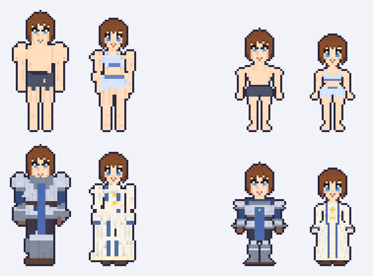
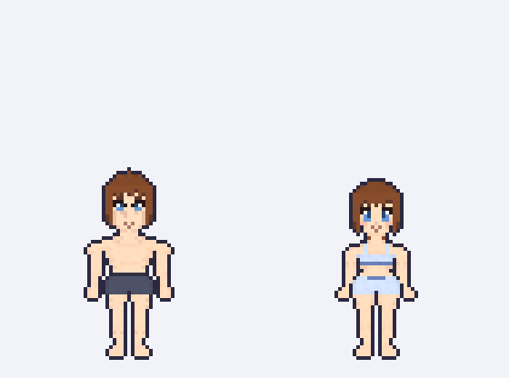
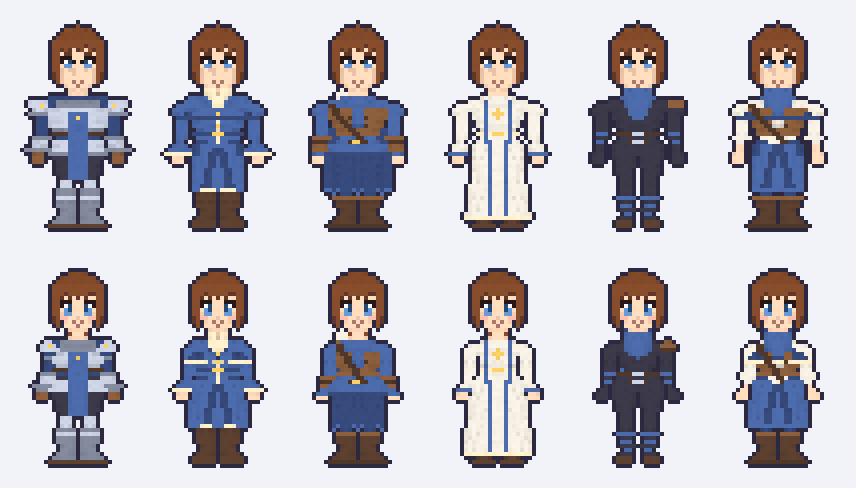
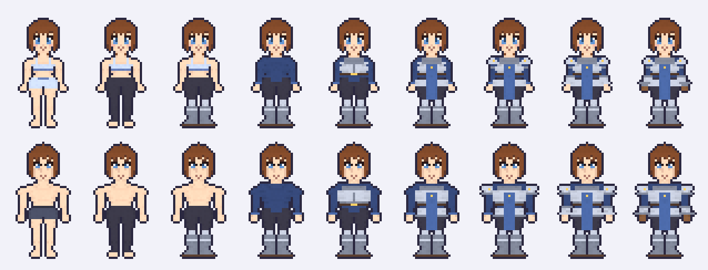
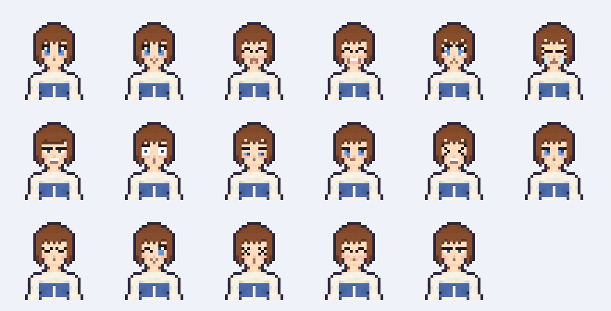
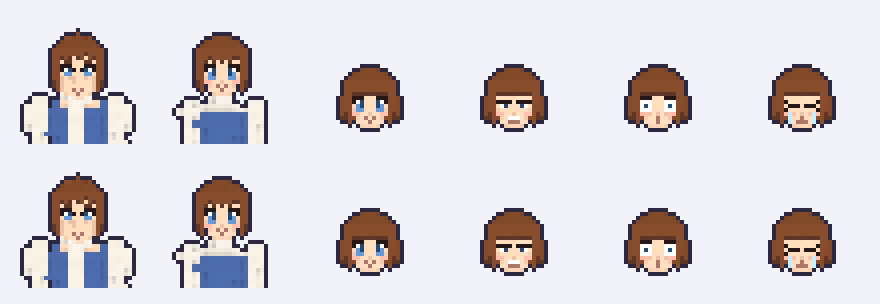

# งานศิลป์: ตัวละคร voxel แบบ Voxel Realm

ตัวละครของเกมสร้างด้วยวิธีเดียวกับ Voxel Realm (โปรเจกต์ก่อนหน้าของ Phupha) ทุกอย่าง โค้ดตัวละครของ Voxel Realm ถูกแปลงจาก GDScript มาเป็น JavaScript ล้วนใน `voxel/` ไม่ต้องใช้ Godot และไม่ต้องติดตั้งอะไรเพิ่ม

- **ร่าง** ปั้นจากรูปทรง (SDF) ตามเพศ เผ่า และสัดส่วน แล้วตัดเป็นชิ้นตามข้อต่อ เกมใช้ร่างสูง 3.25 หัวใน `voxel/vn.mjs` (หัวข้อถัดไป) ส่วนร่างเดิมของ Voxel Realm เก็บไว้ใช้ตรวจเทียบ
- **ชุด** เป็นชิ้น voxel ที่ทาลงบนร่างทีละชิ้นตามช่อง (ขา เท้า ตัว เสื้อนอก เอว ไหล่ แขน มือ หลัง คอ) เปลี่ยนชิ้นไหนก็ทาใหม่แค่ชิ้นนั้น ไม่มีการวาดตัวละครทั้งตัวใหม่
- **หัว** voxel ขนาด 1/32 ม. หน้า 17 อารมณ์ ผม 21 ทรง เขา หาง และของบนหัว
- **ภาพ** ถ่ายหน้าตรงแบบ orthographic ด้วยแสงและ shader เดียวกับห้องถ่ายภาพของ Voxel Realm 1 พิกเซลต่อ voxel แล้วตีขอบเข้ม 1 พิกเซล

## ร่างของเกม: สูง 3.25 หัว

Phupha ขอแบบ Voxel Realm แต่หัวใหญ่ขึ้นและอวัยวะถูกต้อง แล้วเลือกความสูง 3.25 หัวเมื่อ 7 พ.ย. 2026 ร่างนี้อยู่ใน `voxel/vn.mjs` ปั้น แต่งตัว และวาดภาพด้วยโค้ดชุดเดียวกับ Voxel Realm ต่างกันแค่สัดส่วนกับรูปทรง และเป็นค่าเริ่มต้นของ sprite ทุกแบบ

- หัว หน้า ผม และ 17 อารมณ์ เหมือน Voxel Realm ทุกพิกเซล ร่างเตี้ยลงจนทั้งตัวสูง 3.25 หัว (ของเดิมราว 3.75 หัว) ผู้ชายสูง 51 พิกเซล ผู้หญิง 48 พิกเซล ไม่นับขอบ
- ร่างละเอียด 1/32 ม. เท่ากับหัว ไม่ย่อเป็น voxel 2×2 จึงมีข้อมือ มือ ข้อเท้า เท้า และซ้ายขวาเท่ากันทุกพิกเซล
- คอโผล่ บ่าลาดลงหาหัวไหล่ ไม่มีไหล่โป่งเหมือนใส่บ่าเสริม แขนห่างลำตัว 1 พิกเซล มือกว้างกว่าข้อมือ เท้ากว้างกว่าข้อเท้าและปลายเท้าหันออกเล็กน้อย
- ชุดทุกชิ้นใส่ได้เลย ระยะในโค้ดชุดย่อตามร่าง ส่วนบนร่าง Voxel Realm ค่าย่อเป็น 1 ทั้งหมด ภาพจึงเหมือนเดิมทุกพิกเซล

ฝั่งซ้ายคือร่าง Voxel Realm ฝั่งขวาคือร่างของเกม ขยายเท่ากันและยืนบนพื้นเดียวกัน หัวเท่าเดิม ตัวเตี้ยลงและรูปทรงแก้ใหม่



ภาพเต็มตัวใช้ canvas 64×96 ตามข้อ A2 เท้าอยู่แถวเดียวกันทุกตัว หน้าอยู่พิกเซลเดียวกับภาพ portrait ตัวที่สูงที่สุดตอนนี้ (เอลฟ์ชายใส่หมวกขนนก) สูง 60 พิกเซลรวมขอบ เหนือหัวจึงยังว่างอีกมาก เก็บไว้สำหรับหมวก เขา หรือท่ายกแขน ขนาด canvas จะตกลงกับ Phupha อีกครั้งตอนต่อเข้าเกม



ชุดเริ่มต้นของทั้ง 6 class บนร่างชายและหญิง



ชุดนักรบใส่ทีละชิ้น จากตัวเปล่าถึงครบชุด



17 อารมณ์ เรียงตามลำดับของ Voxel Realm: ปกติ ยิ้ม ดีใจ หัวเราะ เศร้า ร้องไห้ โกรธ ตกใจ เขิน ยิ้มเยาะ เจ็บ ง่วง หลับ ขยิบตา สลบ กิน จดจ่อ



## ตรงกับ Voxel Realm แค่ไหน

`tools/voxel-verify.mjs` วาด sprite ชุดเดียวกับที่ Voxel Realm bake ไว้ใน `client/assets/ui/creator` บนร่างเดิมของ Voxel Realm แล้วเทียบทีละพิกเซล: portrait เผ่ามนุษย์ชายหญิง หน้า 17 อารมณ์ และ portrait ของ origin 19 แบบที่ใช้ชุดในตัว รวม 38 ภาพ 25,568 พิกเซล รูปทรงตรงทุกพิกเซล สีตรงเป๊ะ 95.9% ที่เหลือต่างกัน 1 ถึง 2 ระดับสี เพราะ GPU ปัดเศษแสงบิตสุดท้ายต่างกัน มองด้วยตาไม่เห็น

face icon มีแต่หัว จึงออกมาเหมือนกันทุกพิกเซลไม่ว่าใช้ร่างไหน (ตรวจครบ 11 เผ่า ชายหญิง 17 อารมณ์)

แถวบนคือ sprite ของ Voxel Realm แถวล่างคือที่วาดใหม่



## ใช้งาน

```sh
# sprite ตัวเดียวบนร่างของเกม: full (เต็มตัว 64×96) portrait (32×32) หรือ face (20×20)
node art/tools/voxel-render.mjs full '{"race":"human","body":1,"hs":4,"cls":"warrior"}' --expr smile --scale 4 --out warrior.png

# ร่างความสูงอื่น (--vn ตามด้วยจำนวนหัว) หรือร่างเดิมของ Voxel Realm
node art/tools/voxel-render.mjs full '{"race":"human","body":1,"hs":4,"cls":"cleric"}' --vn 3 --out cleric.png
node art/tools/voxel-render.mjs portrait '{"race":"human","body":1,"hs":4}' --voxel-realm --out portrait.png

# ภาพทั้งหมดใน preview/voxel/ (ใส่โฟลเดอร์ของ Voxel Realm ด้วยถ้าจะสร้าง match.png)
node art/tools/voxel-preview.mjs [voxel/client/assets/ui/creator]

# เทียบกับ sprite ของ Voxel Realm หลังแก้โค้ดใน voxel/ ทุกครั้ง
node art/tools/voxel-verify.mjs <voxel/client/assets/ui/creator>
```

ในโค้ด `fullBody(look)` `portrait(look)` และ `faceIcon(look, expr)` ใช้ร่างของเกมอยู่แล้ว ถ้าต้องการร่างอื่นให้ส่ง `style` เช่น `fullBody(look, { style: vnStyle(3) })` หรือ `{ style: VOXEL_REALM }`

ค่าของตัวละครใช้ชื่อเดียวกับ `CharAppearance.to_dict()` ของ Voxel Realm: `race` `body` (0 ชาย 1 หญิง) `skin` `hs` (ทรงผม) `hc` (สีผม) `eye` `om` `ot` (สีชุดหลักและรอง) `cls` `acc` (ของบนหัว) `outfit` ส่วน `outfit` ใช้เปลี่ยนชิ้นตามช่อง เช่น `{"body": "coat"}` ใส่เสื้อโค้ตแทนชิ้นเดิม `{"over": ""}` ถอดเสื้อนอก `{"bare": true}` เหลือแค่ชุดชั้นใน ใช้เวลาวาดราว 9 ms ต่อตัว จึงวาดสดในเกมได้

## ไฟล์ใน `voxel/`

| ไฟล์ | มาจาก (Voxel Realm) | หน้าที่ |
| --- | --- | --- |
| `gd.mjs` | | เลียนแบบคณิตของ Godot: float32, ปัดเศษ, smoothstep, สุ่ม PCG32 |
| `appearance.mjs` | `char_appearance.gd` `char_races.gd` | ค่าของตัวละคร สีผิว ผม ตา ชุด เผ่า |
| `pal.mjs` | `char_models.gd` `palette.gd` | palette ของตัวละคร |
| `grid.mjs` | `voxel_data.gd` `models.gd` | กริด voxel และเครื่องมือวาด |
| `body.mjs` | `char_body.gd` | ปั้นร่าง ผิว ชุดชั้นใน ตัดชิ้นตามข้อต่อ |
| `outfits.mjs` | `char_outfits.gd` | ชิ้นชุดในตัวทั้งหมด และชุดเริ่มต้นของแต่ละ class |
| `head.mjs` | `char_models.gd` | หัว หน้า อารมณ์ ผม เขา หาง ของบนหัว |
| `rig.mjs` | `char_rig.gd` | ประกอบชิ้นตามข้อต่อในท่ายืน |
| `render.mjs` | `mesher.gd` `voxel.gdshader` `char_portrait.gd` | mesh ด้านหน้า แสง เงา AO ขอบเส้น crop |
| `sprite.mjs` | `char_portrait.gd` `creator_icon_bake.gd` | portrait, face icon และภาพเต็มตัว |
| `vn.mjs` | | ร่างของเกม (3.25 หัว): สัดส่วนหัวใหญ่ขึ้นและรูปทรงอวัยวะที่แก้ใหม่ |
| `sheet.mjs` `png.mjs` | | เรียงภาพ อ่านเขียน PNG |

## ยังไม่ได้แปลง

ชุดจากระบบ Equipment ของ Voxel Realm (`gear_*.gd`: ชิ้น `g_*` หมวก `h_*`) อาวุธ และท่าทางจากแอนิเมชัน ชิ้นชุดใหม่ของโลกเถ้ากับดาวจะเขียนเพิ่มใน `outfits.mjs` แบบเดียวกับชิ้นเดิม หลัง Phupha อนุมัติแบบ
