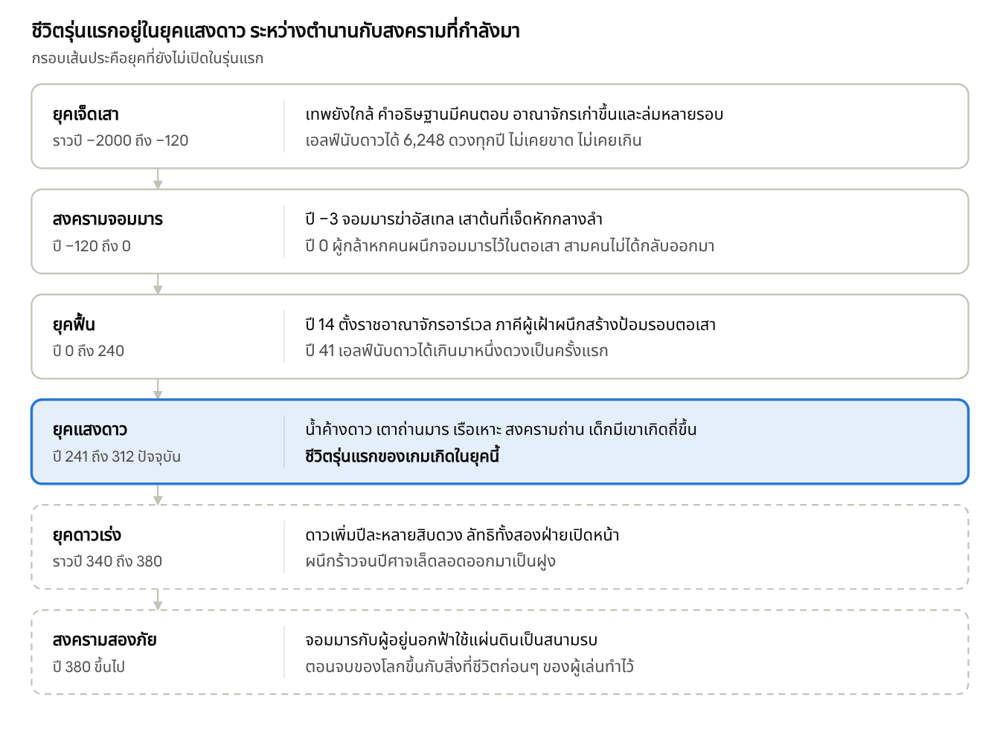
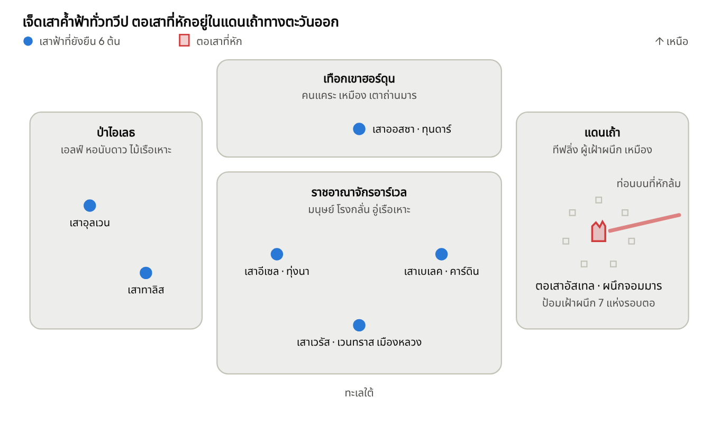

# คัมภีร์โลก

> ฉบับอนุมัติ 7 พ.ย. 2026 (Phupha เลือก "ใช้ตามแนะนำ") สำเนาจาก Claude Doc [คัมภีร์โลก](https://claude.ai/artifact/DeUqPFtE1tNXe9o9hVUKkL) ซึ่งเป็นต้นฉบับ จะเปลี่ยนอะไรต้องถาม Phupha ก่อน แก้ที่ doc ก่อนแล้วค่อยอัปเดตไฟล์นี้

## ภาพรวม

แผ่นดินเจ็ดเสา ปีที่ 312 แห่งศักราชผนึก เรือเหาะของราชนาวีลอยต่ำเหนือหลังคาเมืองหลวงจนเงาบังตลาดทั้งตลาด ทหารผ่านศึกที่เสียแขนได้แขนเหล็กมาใส่แทน แต่คืนไหนฟ้าเปิด คนที่นั่งนับดาวจะบอกได้ว่าดาวมีมากกว่าปีที่แล้ว และในตลาดทุกเมืองมีคนกระซิบกันว่าผนึกจอมมารเริ่มร้าว

**Brief จาก Phupha (7 พ.ย. 2026):** โลกแฟนตาซีราวยุคปฏิวัติอุตสาหกรรมที่ยังเหลือกลิ่นยุคกลางตอนปลาย มีเวทมนตร์ เทพ และสิ่งลี้ลับ ภัยร้ายกำลังคืบเข้ามา ทั้งเทพต่างมิติแนว Lovecraft ที่พยายามเข้ามาในโลกนี้ และข่าวลือการกลับมาของจอมมาร ต่อมา Phupha เลือกในการ์ดว่าจอมมารกับเทพนอกมิติเป็นศัตรูกัน โลกติดอยู่ตรงกลาง และเทคโนโลยีเป็นจักรกลเวท มีเรือเหาะ แขนกล และเครื่องจักรขับด้วยเวท

### โลกนี้ในหนึ่งนาที

- **ฟ้ามีเปลือก** เจ็ดเทพปักเสาฟ้าเจ็ดต้นค้ำเปลือกฟ้าที่ครอบแผ่นดินไว้ ข้างนอกคือความมืดที่มีบางอย่างอาศัยอยู่ คนในโลกเรียกสิ่งนั้นว่า "ผู้อยู่นอกฟ้า"
- **เทพองค์หนึ่งตายแล้ว** 312 ปีก่อน จอมมารฆ่าอัสเทล เทพแห่งดวงดาวและความรู้ เสาต้นที่เจ็ดหักกลางลำ สี่เผ่ารวมกำลังกันผนึกจอมมารไว้ใต้ตอเสานั้น ปฏิทินเริ่มนับปีจากวันผนึก
- **ดาวเพิ่มขึ้นทุกปี** ตั้งแต่ไม่มีเทพคอยนับดาว ดาวดวงใหม่ก็โผล่ขึ้นเรื่อยๆ หอดูดาวจดไว้ทุกดวง สิ่งที่คนส่วนใหญ่ยังไม่รู้คือดาวแต่ละดวงเป็นรูบนเปลือกฟ้า
- **เมืองวิ่งด้วยพลังของศัตรู** ช่างเวทกลั่นแสงจากดาวดวงใหม่เป็นน้ำค้างดาว ใช้ยกเรือเหาะ จุดตะเกียง และขับแขนกล ยิ่งดาวเพิ่ม เชื้อเพลิงยิ่งถูก งานหนักอย่างหัวรถจักรและโรงหลอมใช้ถ่านมาร ที่ขุดจากแดนเถ้ารอบผนึกจอมมาร ความรุ่งเรืองของยุคนี้จึงตักมาจากศัตรูทั้งสองฝ่าย
- **สองภัยเกลียดกันเอง** จอมมารถือว่าแผ่นดินนี้เป็นของเขา ผู้อยู่นอกฟ้าอยากกลืนทั้งแผ่นดิน สองฝ่ายเป็นศัตรูกัน แต่กำลังมาพร้อมกัน และต่างมีลัทธิของตัวเองในหมู่คน
- **ของเก่ายังไม่ตาย** ปราสาท อัศวิน ศาลศาสนา และการล่าแม่มดยังอยู่ครบ ชนบทยังไถนาด้วยวัว ขณะที่เรือเหาะบินผ่านหัว
- **เด็กมีเขาเกิดถี่ขึ้น** ทีฟลิ่งคือเด็กที่เกิดมาพร้อมตราของจอมมารในสายเลือด สิบปีหลังมานี้เกิดมากผิดปกติ คนจึงเชื่อว่าผนึกกำลังคลาย
- **ผู้เล่นเป็นคนธรรมดา** เกิดหนึ่งครั้ง ตายหนึ่งครั้ง ไม่มีใครเลือกให้เป็นผู้กล้า ทุกชีวิตอยู่ในโลกเดียวกันคนละยุค ของ ชื่อเสียง และศัตรูที่ชีวิตก่อนทิ้งไว้ ยังรอให้ชีวิตถัดไปมาเจอ

### โทน

ผสมแต่เอนไปทางหม่นตาม L2 ชีวิตประจำวันมีทั้งความอบอุ่น เรื่องขำ และความรัก ส่วนความน่ากลัวคืบมาทีละนิดผ่านรายละเอียดเล็กๆ เช่น เพลงกล่อมเด็กที่ไม่มีใครรู้ว่าใครแต่ง หรือคนงานกะดึกทั้งโรงที่ฝันเรื่องเดียวกัน ความตายมีน้ำหนักและไม่ย้อนกลับ ระดับเนื้อหา 15+ ตาม L9

Phupha อนุมัติเอกสารนี้ตามคำแนะนำทุกข้อเมื่อ 7 พ.ย. 2026 รายการที่อนุมัติอยู่ในหัวข้อสุดท้าย เรื่องศิลป์ยังต้องตัดสินกันใน thread ศิลป์ จะเปลี่ยนอะไรต่อจากนี้ต้องถาม Phupha ก่อน แล้วแก้ที่เอกสารนี้ก่อนที่อื่น

## ประวัติศาสตร์และยุค

ปฏิทินของแผ่นดินเจ็ดเสานับปีจากวันผนึกจอมมาร ปัจจุบันคือปี 312 ชีวิตในเกมรุ่นแรกเกิดในยุคแสงดาว ยุคก่อนหน้าเป็นตำนานที่ตัวละครเล่าต่อกัน ส่วนยุคหลังจากนี้เปิดทีหลังเป็นเนื้อหาเพิ่ม

### ก่อนกาล

ก่อนมีเทพ แผ่นดินลอยเปลือยอยู่ในความมืด ใต้ดินลึกลงไปมีปีศาจอาศัยอยู่ก่อนแล้ว เจ็ดเทพมาจากไหนไม่มีบันทึก รู้แต่ว่าพวกท่านปักเสาฟ้าเจ็ดต้นแล้วกางเปลือกฟ้าคลุมไว้

สี่เผ่าเกิดและเติบโตใต้เปลือกนั้น ปีศาจถูกกดลงไปอยู่เบื้องล่าง และไม่เคยลืมว่าใครอยู่ที่นี่ก่อน

แผ่นดินที่เทพมาเจอไม่ได้ว่างเปล่า บนดินมีเจ้าของอยู่ก่อนแล้วเจ็ดตน คือแม่น้ำ ไฟ ป่า และลมที่ลุกขึ้นเดินได้ คนรุ่นหลังเรียกรวมกันว่าเจ้าเดิม เทพไม่ได้รบกับเจ้าเดิม ทั้งสองฝ่ายทำสัญญากัน แล้วเสาฟ้าแต่ละต้นก็ปักลงบนที่ที่เจ้าเดิมตนหนึ่งยอมหลับ (ดูหัวข้อเจ้าเดิม)

### ยุคเจ็ดเสา (ราวปี −2000 ถึง −120)

ยุคที่เทพยังใกล้ คำอธิษฐานมีคนตอบจริง อาณาจักรเก่าขึ้นและล่มหลายรอบ ทิ้งสุสานและเมืองใต้ดินไว้ให้นักผจญภัยรุ่นหลังขุด

เอลฟ์เริ่มนับดาวในยุคนี้ นับได้ 6,248 ดวงทุกปี ไม่เคยขาด ไม่เคยเกิน

### สงครามจอมมาร (ปี −120 ถึง 0)

คนแคระขุดเหมืองลึกเกินไปจนทะลุถึงเบื้องล่าง จอมมารเดินขึ้นมาตามทางนั้น พร้อมกองทัพปีศาจที่รอมาสองพันปี ภายในร้อยปีเขายึดแผ่นดินได้สองในสาม คนนับไม่ถ้วนคุกเข่ารับตราของเขาเพื่อให้ลูกรอด

ปี −3 จอมมารปีนเสาต้นที่เจ็ดขึ้นไปถึงยอดแล้วฆ่าอัสเทล เสาหักกลางลำ ท่อนบนล้มลงมานอนยาวเป็นแนวเขาทางตะวันออก

ปี 0 ผู้กล้าหกคนจากสี่เผ่า แต่ละคนได้พรจากเทพหนึ่งองค์ ล่อจอมมารเข้าไปในตอเสาแล้วผนึกไว้ข้างใน สามคนไม่ได้กลับออกมา อาวุธและเครื่องรางของทั้งหกกระจัดกระจายไปหมดแล้ว และเป็นของระดับอาร์ติแฟกต์ในเกม

### ยุคฟื้น (ปี 0 ถึง 240)

ราชอาณาจักรอาร์เวลตั้งขึ้นในปี 14 ราชวงศ์อ้างว่าสืบเชื้อสายจากหนึ่งในผู้กล้าทั้งหก ภาคีผู้เฝ้าผนึกสร้างป้อมรอบตอเสาและเฝ้ามาจนวันนี้ ศาสนจักรตะเกียงเริ่มล่าคนที่มีตรามาร และไม่เคยหยุด

ปี 41 เอลฟ์นับดาวได้เกินมาหนึ่งดวงเป็นครั้งแรก ไม่มีมนุษย์คนไหนสนใจ ร้อยปีต่อมาดาวเกินมาสามสิบดวง ราชสำนักจึงตั้งหอดูดาวหลวงขึ้นมานับเอง

### ยุคแสงดาว (ปี 241 ถึงปัจจุบัน)

ปี 241 อาจารย์โอเดล คอร์ดิส แห่งสถาบันเวทหลวง พบว่าแสงจากดาวดวงใหม่กลั่นเป็นของเหลวได้ ดาวเก่าไม่ให้อะไรเลย คนเรียกของเหลวนั้นว่าน้ำค้างดาว หกสิบปีต่อมา ทุกหลังคาในเมืองหลวงมีจานรับดาว

- **ปี 263** คนแคระจุดเตาถ่านมารเตาแรก
- **ปี 289** เรือเหาะลำแรกขึ้นจากอู่หลวง
- **ปี 296 ถึง 301** สงครามถ่าน อาร์เวลรบกับสภาตระกูลคนแคระแย่งเหมืองถ่านมาร ทหารผ่านศึกจำนวนมากกลับบ้านพร้อมแขนหรือขาเหล็ก
- **ปี 302** ทะเบียนวิหารเริ่มบันทึกเด็กมีเขาเกิดถี่ขึ้น
- **ปี 312** หอดูดาวหลวงนับดาวได้ 7,140 ดวง

### ยุคถัดไป (ยังไม่เปิดในรุ่นแรก)

- **ยุคดาวเร่ง (ราวปี 340 ถึง 380)** ดาวเพิ่มปีละหลายสิบดวง ลัทธิทั้งสองฝ่ายเปิดหน้า ผนึกร้าวจนปีศาจเล็ดลอดออกมาเป็นฝูง
- **สงครามสองภัย (ปี 380 ขึ้นไป)** จอมมารกับผู้อยู่นอกฟ้าใช้แผ่นดินเป็นสนามรบ ตอนจบของโลกไม่ตายตัว ขึ้นกับสิ่งที่ชีวิตก่อนๆ ของผู้เล่นทำไว้

### ชีวิตผู้เล่นกับยุค

รุ่นแรกเปิดยุคแสงดาวเป็นหลัก ตัวละครเกิดระหว่างปี 270 ถึง 300 วัยหนุ่มสาวจึงตรงกับปัจจุบันของโลก ส่วนบั้นปลายอาจเลยเข้าต้นยุคดาวเร่ง ซึ่งรุ่นแรกเล่าแค่เท่าที่คนคนหนึ่งเห็น เช่น ดาวที่เพิ่มเร็วขึ้น โดยยังไม่เปิดสงคราม ของตกทอดจากชีวิตก่อนโผล่มาในฐานะของคนรุ่นก่อน เช่น ในร้านรับจำนำ ในห้องเก็บของวิหาร หรือบนหิ้งบ้านยาย โดยไม่ผูกปีให้เป๊ะ พอมีเนื้อหายุคดาวเร่งแล้ว ค่อยให้เวลาเดินหน้า ชีวิตถัดไปเกิดหลังชีวิตก่อนตาย และได้ยินเรื่องของตัวเองในฐานะตำนาน

## ทวีปและแคว้น

แผ่นดินเจ็ดเสามีสี่แคว้น ทุกแคว้นมีเสาฟ้าอย่างน้อยหนึ่งต้น ยกเว้นแดนเถ้าที่เหลือแค่ตอ เสาสูงจนยอดหายเข้าไปในเมฆ คนทั้งทวีปใช้เสาที่มองเห็นบนขอบฟ้าบอกทิศ

| แคว้น | ทิศ | ผู้คน | เสาฟ้า |
| --- | --- | --- | --- |
| ราชอาณาจักรอาร์เวล | กลางถึงชายฝั่งใต้ | มนุษย์ และทุกเผ่าที่มาหางาน | เวรัส อีเซล เบเลค |
| เทือกเขาฮอร์ดุน | เหนือ | คนแคระ คนงานเหมือง | ออสซา |
| ป่าไอเลธ | ตะวันตก | เอลฟ์ พราน หมู่บ้านชายป่า | อุลเวน ทาลิส |
| แดนเถ้า | ตะวันออก | ทีฟลิ่ง ผู้เฝ้าผนึก คนขุดถ่าน | ตอเสาของอัสเทล |

### ราชอาณาจักรอาร์เวล

เมืองหลวงเวนทราสตั้งอยู่ปากแม่น้ำริมทะเลใต้ กลางคืนสว่างทั้งเมืองด้วยตะเกียงสีฟ้าของน้ำค้างดาว ทุกหลังคามีจานโลหะหงายรับแสง เรือเหาะผูกเรียงกันที่หอท่าริมแม่น้ำ

เดินออกจากกำแพงเมืองครึ่งวันก็เจอหมู่บ้านที่ยังจุดเทียนไข เคยเห็นเรือเหาะแค่เป็นจุดดำบนฟ้า และยังเชื่อว่าเด็กมีเขาควรเอาไปวางทิ้งไว้ที่ทางสามแพร่ง กษัตริย์ยังนั่งบัลลังก์ แต่คนที่ให้บัลลังก์กู้เงินคือธนาคารเบเลค

**ปัญหาของยุค:** ขุนนางเก่าเสียที่ดินให้เจ้าของโรงงาน เด็กแปดขวบทำงานในโรงกลั่น ทหารผ่านศึกแขนเหล็กไม่มีงาน ศาสนจักรตะเกียงล่าแม่มดถี่ขึ้น ส่วนชาวประมงชายฝั่งใต้เล่าว่าคืนเดือนมืด ดาวในน้ำมีมากกว่าดาวบนฟ้า

### เทือกเขาฮอร์ดุน

เมืองคนแคระเจาะเข้าไปในหิน ทางรถไฟไต่เขาเป็นขั้นบันได ปล่องเตาถ่านมารพ่นควันสีสนิมทั้งวันทั้งคืน เสาฟ้าของออสซาตั้งอยู่กลางภูเขาลูกใหญ่ที่สุด เมืองหลวงทุนดาร์สร้างวนรอบโคนเสา และคนแคระฝังศพไว้ในผนังเสา ใกล้เทพแห่งความตายที่สุดเท่าที่คนตายจะไปถึงได้

สงครามถ่านจบมาสิบเอ็ดปี คนแคระแพ้ ต้องส่งถ่านมารให้อาร์เวลในราคาที่อาร์เวลตั้ง หนี้ก้อนนี้สลักอยู่บนกำแพงสภา ทุกคนเดินผ่านทุกวัน ช่างคนแคระทำแขนกลดีที่สุดในทวีป ทหารอาร์เวลหลายคนจึงใส่แขนที่ศัตรูเก่าทำให้

**ปัญหาของยุค:** ในเหมืองเก่ามีชั้นที่ก่อหินปิดตายตั้งแต่สงครามจอมมาร บนหินสลักคำเตือนด้วยอักษรที่คนแคระรุ่นนี้อ่านไม่ออก หนี้สงครามทำให้บางตระกูลเริ่มคุยกันเบาๆ ว่าควรเปิดชั้นนั้น

### ป่าไอเลธ

ต้นไม้ในป่านี้สูงกว่าหอระฆัง อายุมากกว่าทุกอาณาจักรในทวีป เอลฟ์อยู่บนกิ่ง ไม่ใช่ใต้ต้น และสร้างหอนับดาวไว้บนยอดที่สูงที่สุด เสาฟ้าของอุลเวนกับทาลิสตั้งห่างกันหนึ่งวันเดินเท้า ระหว่างสองเสาลมไม่เคยหยุดพัด

ไม้ไอเลธเบาและไม่ผุ อู่เรือเหาะในเวนทราสจึงต้องการมันทุกลำ ค่ายตัดไม้รุกเข้าป่าลึกขึ้นทุกปี หมู่บ้านมนุษย์ชายป่าอยู่กับเอลฟ์มาหลายร้อยปี พูดได้สองภาษา และไม่ไว้ใจทั้งคนเมืองและเอลฟ์พอกัน

**ปัญหาของยุค:** เอลฟ์รุ่นแก่เจรจากับราชสำนัก เอลฟ์รุ่นหนุ่มเผาค่ายตัดไม้ หอนับดาวส่งจดหมายเตือนเรื่องดาวไปเวนทราสทุกปี และได้คำตอบเดิมทุกปี

### แดนเถ้า

ตอเสาของอัสเทลสูงเท่าภูเขา ท่อนบนที่หักลงมานอนยาวไปจนถึงทะเลตะวันออก พื้นดินรอบตอเสาเป็นเถ้าสีเทาลึกถึงเข่า ไม่มีอะไรขึ้นนอกจากหญ้าสีเงินที่กินได้แต่ขม

ภาคีผู้เฝ้าผนึกตั้งป้อมเจ็ดแห่งรอบตอเสา บริษัทเหมืองจากอาร์เวลและฮอร์ดุนขุดถ่านมารจากใต้เถ้า ผู้เฝ้าผนึกร้องเรียนมาสิบปีว่าเหมืองทำให้ผนึกบางลง ไม่มีใครฟัง เพราะหัวรถจักรทั้งทวีปกินถ่านมาร

**ปัญหาของยุค:** ทีฟลิ่งที่หนีการล่าจากแคว้นกลางมาตั้งหมู่บ้านที่นี่ ส่วนใหญ่ทำงานในเหมืองเพราะไม่มีที่อื่นรับ พวกเขาขุดถ่านที่ทำให้ผนึกของจอมมารบางลงทุกวัน และรู้ดีกว่าใครว่ามันแปลว่าอะไร

### ฉากรุ่นแรก 6 ฉาก (ข้อเสนอให้ thread ศิลป์)

1. หมู่บ้านชนบทในอาร์เวล บ้านไม้มุงฟาง โบสถ์เล็ก ทุ่งข้าวสาลี เรือเหาะเป็นจุดบนฟ้าไกลๆ
2. ถนนเวนทราสยามค่ำ ตะเกียงฟ้า จานรับดาวบนหลังคา ปล่องโรงงาน
3. หอท่าเรือเหาะและโรงกลั่นน้ำค้างดาว
4. เมืองในภูเขาฮอร์ดุน เตาถ่านมารแสงแดง ทางรถไฟไต่เขา
5. ป่าไอเลธกับหอนับดาวบนยอดไม้
6. แดนเถ้า ป้อมผู้เฝ้าผนึก และตอเสาบนเส้นขอบฟ้า

## เผ่าพันธุ์

สี่เผ่าใช้ร่างฐานเดียวกันตามแผนศิลป์ ต่างกันที่สีผิว หู เครา เขา และหาง แต่ในเรื่อง แต่ละเผ่ามองยุคนี้คนละแบบ

| เผ่า | อายุขัย | ถิ่นหลัก | โบนัส stat (SRD 5.1) | ชิ้นส่วนบน sprite |
| --- | --- | --- | --- | --- |
| มนุษย์ | ราว 80 ถึง 90 ปี น้อยคนถึงร้อย | อาร์เวล | +1 ทุกค่า | ไม่มี |
| เอลฟ์ | ราว 700 ปี | ป่าไอเลธ | ว่องไว +2 | หูยาว |
| คนแคระ | ราว 350 ปี | ฮอร์ดุน | อึด +2 | เครา (ผู้ชาย) |
| ทีฟลิ่ง | ราว 85 ถึง 95 ปี | เกิดได้ทุกที่ อยู่รวมกันที่แดนเถ้า | เสน่ห์ +2 ปัญญา +1 | เขา หาง |

อายุขัยในตารางคืออายุของคนที่อยู่จนถึงวัยชรา (ปรับตามแผนชีวิต 100 ปี ข้อ D2 เมื่อ 11 พ.ย. 2026 เดิมเขียนว่ามนุษย์ราว 70 ปี ทีฟลิ่งราว 80 ปี) คนจำนวนมากไปไม่ถึงตรงนั้น เพราะไข้ เหมือง และสงคราม

### มนุษย์

อายุสั้นที่สุดในสี่เผ่า และรีบที่สุด สามร้อยปีหลังผนึก มนุษย์สร้างเมืองทับซากสงครามจนลืมไปแล้วว่าเคยกลัวอะไร ยุคนี้ขุนนางที่ถือที่ดินมาสิบชั่วคนกำลังเสียที่นั่งให้คนที่เพิ่งรวยจากโรงกลั่น ลูกชาวนาทิ้งนาเข้าเมืองไปทำงานวันละสิบสี่ชั่วโมง

**เกิดเป็นมนุษย์:** ชาติกำเนิดกำหนดวัยเด็กเกือบทั้งหมด แต่มนุษย์ก็ไต่ชนชั้นได้เร็วที่สุด ลูกคนงานโรงกลั่นเป็นกัปตันเรือเหาะได้ในชีวิตเดียว ถ้าเลือกถูกและโชคดีพอ

### เอลฟ์

เอลฟ์มีลูกยาก บางหมู่บ้านร้อยปีมีเด็กเกิดคนเดียว เด็กทุกคนจึงเป็นลูกของทั้งหมู่บ้าน เอลฟ์ที่แก่ที่สุดยังจำกลิ่นควันของสงครามจอมมารได้ บางคนเคยเห็นหน้าเขา และไม่มีใครยอมเล่าให้จบ

เอลฟ์เปลี่ยนชื่อทุกร้อยปี ชื่อเต็มคือทุกชื่อที่เคยใช้เรียงต่อกัน ใครรู้ชื่อเต็มก็รู้ชีวิตทั้งชีวิตของเอลฟ์คนนั้น จึงบอกกันเฉพาะคนที่ไว้ใจที่สุด เอลฟ์รักอัสเทลมากกว่าเผ่าอื่น หลังท่านตายพวกเขานับดาวแทนมาสามร้อยปี และเป็นเผ่าเดียวที่ไม่ยอมใช้น้ำค้างดาว

**เกิดเป็นเอลฟ์:** แต่ละช่วงชีวิตยาวกว่ามนุษย์หลายเท่า เพื่อนมนุษย์ที่เจอตอนเด็กจะแก่และตายไปต่อหน้า และเอลฟ์อาจได้เห็นยุคถัดไปในชีวิตเดียว

### คนแคระ

คนแคระเชื่อว่าหินจำได้นานกว่าคน ทุกเมืองมีกำแพงชื่อที่สลักชื่อบรรพบุรุษทุกคนไว้ คำสาบานและหนี้ก็สลักลงหินเหมือนกัน คนแคระที่ผิดคำสาบานจะถูกสกัดชื่อออกจากกำแพง โทษนี้หนักกว่าตาย เพราะคนตายยังมีชื่ออยู่บนหิน

บรรพบุรุษของพวกเขาขุดทะลุถึงเบื้องล่างและเปิดทางให้จอมมาร เด็กคนแคระทุกคนรู้เรื่องนี้ แต่ไม่มีใครพูดต่อหน้าคนนอก เครื่องจักรเครื่องแรกของทวีปสร้างขึ้นเพื่อสูบน้ำออกจากเหมืองคนแคระ วันนี้ช่างคนแคระทำแขนกล หัวรถจักร และปืนเวทได้ดีที่สุด

**เกิดเป็นคนแคระ:** เกิดมาพร้อมตระกูลและหนี้ของตระกูล หนี้ที่บรรพบุรุษสลักไว้อาจตกมาถึงตัวละคร และหนี้ที่ตัวละครทิ้งไว้ก็อาจตามไปถึงชีวิตถัดไป

### ทีฟลิ่ง

ระหว่างสงครามจอมมาร คนจำนวนมากคุกเข่ารับตราของเขาเพื่อให้ลูกหลานรอด หลังผนึก ตรานั้นจมหายไปในสายเลือด แล้วโผล่ขึ้นมาในเด็กที่เกิดห่างออกไปหลายชั่วคน เด็กเกิดมามีเขาเล็กๆ ใต้ผม หางบางเท่านิ้ว และตาที่สะท้อนแสงไฟในที่มืด

ไม่มีครอบครัวไหนรู้แน่ว่าบรรพบุรุษเคยคุกเข่าหรือเปล่า ทีฟลิ่งจึงเกิดได้ในบ้านชาวนา ในห้องคลอดของขุนนาง หรือในห้องเช่าหลังโรงกลั่น ในอาร์เวลหลายคนถูกทิ้งไว้หน้าวิหารอีเซลตั้งแต่ยังไม่หย่านม บางบ้านเลื่อยเขาลูกทิ้งแล้วเลี้ยงแบบปิดบัง

ทางการเรียกพวกเขาว่า "ผู้ต้องตรา" ในตลาดเรียกว่า "ลูกมาร" สิบปีหลังมานี้ ทะเบียนวิหารบันทึกเด็กมีเขาเกิดมากกว่าเดิมสามเท่า

**ความลับ:** ตรามารกันอิทธิพลของผู้อยู่นอกฟ้าได้ ทีฟลิ่งไม่ได้ยินเสียงหึ่ง และไม่ฝันร่วมกับคนงานโรงกลั่น ผู้ฟังดาวรู้เรื่องนี้ และกำลังตามล่าพวกเขาอย่างเงียบๆ

**เกิดเป็นทีฟลิ่ง:** การเกิดคือเหตุการณ์แรกที่ต้องลุ้น พ่อแม่จะเก็บไว้ ซ่อนไว้ หรือทิ้ง วัยเด็กจึงแยกเป็นสามทางตั้งแต่วันแรก

## เทพและศาสนา

เทพมีเจ็ดองค์ ยังอยู่หก แต่ละองค์ค้ำเสาฟ้าหนึ่งต้น และผูกกับแนวทางหนึ่งช่องบนสองแกน ระเบียบกับอิสระ และดีกับชั่ว

| เทพ | ดูแล | แนวทาง | สัญลักษณ์ | ผู้นับถือหลัก | เสาอยู่ที่ |
| --- | --- | --- | --- | --- | --- |
| เวรัส | คำสาบาน กฎหมาย แสงสว่าง | ระเบียบ ดี | ตะเกียงแขวน | อัศวิน ผู้พิพากษา ราชสำนัก | เวนทราส |
| อีเซล | เตาไฟ การเกิด การรักษา | กลาง ดี | ชามไฟในสองมือ | หมอตำแย หมอ แม่บ้าน เด็กกำพร้า | ทุ่งนาอาร์เวล |
| ทาลิส | ทาง ลม เพลง อิสรภาพ | อิสระ ดี | ขนนกกับโซ่ขาด | คนเดินทาง นักร้องเร่ ทาสหนี | ป่าไอเลธ |
| ออสซา | ความตาย ประตู ความทรงจำ | ระเบียบ กลาง | ประตูปิด | สัปเหร่อ บรรณารักษ์ คนแคระ | ฮอร์ดุน |
| อุลเวน | ป่า ฤดูกาล การล่า | เป็นกลาง | เขากวางสองกิ่ง | ชาวนา พราน เอลฟ์ | ป่าไอเลธ |
| เบเลค | หนี้ สัญญา เหล็ก | ระเบียบ ชั่ว | ตาชั่งเหล็กคล้องโซ่ | พ่อค้า นายธนาคาร เจ้าของโรงงาน | เมืองคาร์ดิน อาร์เวล |
| อัสเทล (สิ้นแล้ว) | ดวงดาว ความรู้ | เป็นกลาง | ดาวเจ็ดแฉก | ไม่มีใครกล้านับถือเปิดเผย | ตอเสาในแดนเถ้า |

เสาฟ้าทุกต้นเป็นหินสีกระดูก เย็นเสมอแม้กลางแดด วิหารใหญ่ของแต่ละเทพตั้งอยู่ที่โคนเสา คนแสวงบุญเดินทางมาแตะเสาสักครั้งในชีวิต ไม่มีใครปีนถึงยอด นอกจากจอมมาร

### การนับถือ

คนส่วนใหญ่ไหว้ทุกองค์ตามเรื่องที่ขอ อยากมีลูกไหว้อีเซล ขึ้นศาลไหว้เวรัส กู้เงินไหว้เบเลค นักบวชเท่านั้นที่เลือกรับใช้องค์เดียว

ศาสนจักรตะเกียงของเวรัสเป็นศาสนาประจำราชสำนัก ส่วนวิหารเบเลคโตเร็วที่สุดในยุคนี้ หน้าวิหารดูเหมือนธนาคาร เพราะข้างในคือธนาคารจริงๆ สัญญาที่ลงชื่อต่อหน้าเบเลคผูกด้วยเวท คนผิดสัญญาจะหนาวเข้ากระดูกทีละนิด จนกว่าจะใช้หนี้หมด

สัปดาห์หนึ่งมีเจ็ดวัน ตั้งชื่อตามเทพเจ็ดองค์ วันอัสเทลยังอยู่ในปฏิทิน แต่ไม่มีใครทำงานและไม่มีใครฉลอง คนเรียกว่าวันว่าง เด็กที่เกิดวันว่างถูกมองว่าดวงไม่ดี

### เทพที่สิ้นแล้ว

อัสเทลเคยดูแลดวงดาวและความรู้ ตั้งแต่ท่านตาย ความรู้ก็ไม่มีเจ้าของ เวทวิชากลายเป็นของที่ใครมีเงินก็เรียนได้ วิทยาการจึงโตเร็วกว่าทุกยุคที่ผ่านมา

**ความลับ:** คนที่ยังแอบอธิษฐานถึงอัสเทลบางคนได้คำตอบ แต่คำตอบนั้นไม่ได้มาจากอัสเทล

### นักบวชกับแนวทาง (ส่งให้ thread โค้ด)

นักบวชที่แนวทางเลื่อนห่างจากเทพของตัวเองเกินหนึ่งช่องจะเริ่มเสียพลัง และเกิดเหตุการณ์ให้เลือกว่าจะกลับตัว เปลี่ยนเทพ หรือหันไปหาสิ่งอื่นที่ยินดีตอบ

## เจ้าเดิม

ก่อนเจ็ดเทพมาถึง แผ่นดินมีเจ้าของอยู่แล้วเจ็ดตน เจ้าเดิมไม่ใช่เทพ ไม่ต้องการคนไหว้ และไม่สนใจว่าใครดีหรือชั่ว แต่ละตนคือแม่น้ำ ไฟ หรือป่าที่ลุกขึ้นเดินได้ มีรูปเป็นสัตว์เมื่ออยากให้คนเห็น และไม่มีรูปเลยเมื่อไม่อยาก

### สัญญาหลับ

เทพกับเจ้าเดิมไม่ได้รบกัน ทั้งสองฝ่ายทำสัญญา เจ้าเดิมยอมหลับ และยอมให้เทพปักเสาฟ้าลงบนที่ที่ตัวเองนอน เทพให้คำมั่นสองข้อ เปลือกฟ้าจะกันความมืดข้างนอกไว้ และคนที่มาอยู่บนแผ่นดินจะรักษาข้อห้ามของแผ่นดิน เสาฟ้าแต่ละต้นจึงเป็นทั้งเสาค้ำฟ้าและหมุดที่ตรึงเจ้าเดิมไว้

ตอนนี้สัญญากำลังขาดทั้งสองข้อ เปลือกฟ้าเป็นรู และโรงงานกับเหมืองฝืนข้อห้ามทุกวัน เจ้าเดิมจึงเริ่มพลิกตัว

| เจ้าเดิม | ธาตุ | รูป | หลับอยู่ใต้ | ข้อห้ามที่คนยังถือ | ถ้าตื่น |
| --- | --- | --- | --- | --- | --- |
| แม่น้ำเฒ่า | น้ำ | ปลาบึกที่ยาวเท่าลำน้ำ | เสาของเวรัส ที่เวนทราส | ไม่เทของเสียลงน้ำตอนกลางคืน คนเรือโยนเหรียญแรกของปีลงน้ำ | น้ำท่วมเมืองหลวง |
| วัวใต้ทุ่ง | ดิน | วัวตัวเท่าเนินเขา นอนตะแคงอยู่ใต้ทุ่ง | เสาของอีเซล ในทุ่งนาอาร์เวล | ไถอ้อมเนินโดยไม่ไถข้าม เว้นรวงสุดท้ายไว้ในนา | แผ่นดินไหว ทุ่งยุบ |
| แม่เสือไฟ | ไฟ | เสือโคร่งที่ลายเป็นถ่านแดง | เสาของเบเลค ที่คาร์ดิน | ไม่ดับเตาด้วยน้ำ ไฟที่ยืมมาต้องคืนก่อนรุ่ง | ไฟที่ดับไม่ได้ในย่านเตาหลอม |
| ยายหมีหิน | หินและฤดูหนาว | หมีแก่ที่ขนเป็นหินชนวน | เสาของออสซา ในฮอร์ดุน | เคาะหินสามครั้งก่อนเจาะ ไม่ขุดในเดือนที่หนาวที่สุด | เหมืองถล่ม ฤดูหนาวยาวข้ามปี |
| กวางไม่มีเขา | ป่า | กวางตัวเมียที่สูงเท่ายอดไม้ | เสาของอุลเวน ในป่าไอเลธ | ไม่โค่นไม้เป็น ไม่ล่าสัตว์ที่มีลูกอ่อน | ป่าเดินเข้าเมือง |
| ฝูงนกไม่มีรัง | ลม | ฝูงนกที่ไม่เคยลงเกาะ มองไกลๆ เป็นตัวเดียว | เสาของทาลิส ในป่าไอเลธ | ไม่ขังนกป่า เปิดหน้าต่างไว้บานหนึ่งเมื่อมีคนตาย | พายุที่พัดเรือเหาะตก |
| เค้ากลางคืน | ความมืด | นกเค้าที่กางปีกแล้วเป็นกลางคืน | ตอเสาของอัสเทล ในแดนเถ้า | ไม่ชี้ดาว ไม่นับดาวออกเสียง | ตื่นแล้วตั้งแต่ปี −3 |

ชื่อทั้งเจ็ดเป็นคำไทยที่บอกลักษณะ ตามหลักตั้งชื่อที่ให้ของเก่าและของชาวบ้านใช้ชื่อแบบนี้ ต่างจากเทพที่ชื่อสองพยางค์และปีศาจที่ชื่อยาว

เรื่องนี้อธิบายของที่มีอยู่แล้วในโลกได้สามอย่าง เวทพื้นถิ่นที่ยิ่งไกลบ้านยิ่งอ่อน คือลมหายใจของเจ้าเดิมตนที่หลับอยู่ใกล้ที่สุด ธรรมเนียมแปลกๆ ของแต่ละหมู่บ้านคือข้อห้ามที่เหลือมาจากสัญญา และเขากวางสองกิ่งที่เป็นสัญลักษณ์ของอุลเวน คือเขาที่กวางไม่มีเขามอบให้เป็นของค้ำสัญญา

**ความลับ:** เบเลคซึ่งเป็นเทพแห่งหนี้เป็นหนี้เสียเอง ไฟที่ใช้ตีเหล็กก้อนแรกเป็นไฟที่ยืมจากแม่เสือไฟ และยังไม่เคยคืน วิหารเบเลคปิดเรื่องนี้ไว้

### เค้ากลางคืน

เค้ากลางคืนเป็นเจ้าเดิมตนเดียวที่ตื่นอยู่ เสาของอัสเทลหักตั้งแต่ปี −3 หมุดที่ตรึงมันจึงหลุด มันบินเหนือแดนเถ้าทุกคืนเดือนดับ และเจ็บทุกครั้งที่มีดาวดวงใหม่ เพราะแสงจากข้างนอกส่องเข้ามาในกลางคืนที่เคยเป็นของมัน

มันไม่อยู่ข้างเทพ ไม่อยู่ข้างจอมมาร และจำทุกอย่างก่อนมีเทพได้ คนที่ไปถึงมันจะได้ฟังเรื่องสัญญาหลับจากปากของคู่สัญญาเอง

### เจ้าเดิมกับชีวิตคน

- คนแก่ในทุกถิ่นสอนข้อห้ามของถิ่นตัวเองให้เด็ก โดยไม่มีใครจำได้แล้วว่าห้ามเพราะอะไร
- คนที่ถือข้อห้ามมาทั้งชีวิตบางคนได้พรของเจ้าเดิมประจำถิ่น คนที่ฝืนซ้ำๆ ได้คำสาป ทั้งสองอย่างไม่มีใครประกาศ มันแค่เกิดขึ้น
- ลูกหลานของเจ้าเดิมที่ลุกขึ้นมาเดินไม่ได้ชั่ว แค่ตื่น การปะทะกับพวกนี้จบได้ด้วยการทำให้สงบ ไม่ต้องฆ่า
- เจ้าเดิมน่าเกรงขามแต่ไม่น่าขนลุก มันเก่าและใหญ่ ไม่ได้ผิดธรรมชาติ ความต่างจากผู้อยู่นอกฟ้าต้องอ่านออกจากน้ำเสียงของเรื่อง

## จอมมารและผู้อยู่นอกฟ้า

ภัยสองฝ่ายกำลังมาพร้อมกันและเกลียดกันเอง จอมมารอยากได้แผ่นดินคืน ผู้อยู่นอกฟ้ากำลังซึมเข้ามากลืนมัน ทั้งสองฝ่ายมีคนในหมู่มนุษย์คอยเปิดทางให้

|  | จอมมาร | ผู้อยู่นอกฟ้า |
| --- | --- | --- |
| มาจาก | เบื้องล่างของแผ่นดิน อยู่ก่อนเทพ | ความมืดนอกเปลือกฟ้า |
| ตอนนี้อยู่ที่ | ในตอเสาของอัสเทล ใต้ผนึก | ข้างนอก กดเปลือกฟ้าจนเป็นรู |
| ต้องการ | ฆ่าเทพที่เหลือ ครองแผ่นดินแบบเดิม | ไม่มีใครรู้ อาจแค่หิว |
| ทางเข้า | ผนึกที่บางลง และคนที่มีตรา | ดาวดวงใหม่ และคนที่ตั้งใจฟัง |
| ในชีวิตประจำวัน | ปีศาจเล็ดลอดในแดนเถ้า เสียงทุ้มในฝันของคนมีตรา คนงานเหมืองโมโหง่าย | เสียงหึ่ง ฝันร่วม ผิวแก้ว |
| เชื้อเพลิงที่มาจากฝั่งนี้ | ถ่านมาร | น้ำค้างดาว |
| ลัทธิ | ลัทธิเถ้า | ผู้ฟังดาว |
| ใครไม่โดนอิทธิพล | คนที่แสงดาวซึมเข้าตัวแล้ว | คนที่มีตรามาร |

### จอมมาร

ชื่อจริงของเขาคือวาร์ซาเรธ แต่ไม่มีใครพูดออกเสียง คนทั่วไปเรียกจอมมาร ทหารเก่าเรียกราชาเถ้า ผู้เฝ้าผนึกเรียกสั้นๆ ว่า "คนข้างใน"

เขาไม่ใช่สัตว์ร้ายที่คลั่ง เขาอดทน ฉลาด และรักษาคำพูดทุกคำ ปีศาจอยู่บนแผ่นดินนี้ก่อนเทพจะมา ในสายตาเขา เจ็ดเทพคือผู้บุกรุก และสี่เผ่าคือฝูงสัตว์ที่ผู้บุกรุกเลี้ยงไว้

เขาเกลียดผู้อยู่นอกฟ้าเพราะแผ่นดินนี้เป็นของเขา ใครจะกินต้องข้ามศพเขาก่อน เขารู้ว่าการฆ่าอัสเทลทำให้เปลือกฟ้าเริ่มเป็นรู แต่ไม่เคยยอมรับว่าตัวเองพลาด

ตอนนี้ผนึกบางพอให้เสียงของเขาลอดเข้าไปในฝันของคนที่มีตรา เขาเสนอข้อตกลง ปกป้องจากดาวแลกกับการช่วยปลดผนึก ทุกข้อตกลงเป็นจริงตามตัวอักษร และไม่มีข้อไหนที่คนรับประโยชน์เท่าเขา

**ความลับ:** ผู้กล้าสามคนที่ไม่ได้กลับออกมาไม่ได้ตาย พวกเขายังอยู่ในตอเสา และตัวพวกเขาคือผนึก สามร้อยสิบสองปีแล้ว ถ่านมารที่ขุดได้คือความร้อนที่รั่วออกมาจากการต่อสู้ที่ยังไม่จบข้างในนั้น

### ผู้อยู่นอกฟ้า

ไม่มีใครเคยเห็นรูปร่างเต็มของพวกมัน และไม่มีชื่อที่ปากคนออกเสียงได้ นักวิชาการยังเถียงกันว่ามีหลายตน หรือเป็นตนเดียวที่มีหลายด้าน ความจริงที่มีแต่ผู้ฟังดาวรู้ และหอนับดาวเริ่มสงสัย คือดาวทุกดวงที่เกิดหลังปี 41 คือจุดที่เปลือกฟ้าสึกจนทะลุ และแสงที่ลอดเข้ามาไม่ใช่แสงธรรมดา

หอนับดาวแบ่งสิ่งที่คนเจอเป็นสามด้าน

- **ผู้มองลงมา** คนที่นั่งมองดาวดวงใหม่นานๆ จะเริ่มรู้สึกว่ามีอะไรมองกลับ นักดาราศาสตร์หลวงสองคนเขียนสมการเต็มผนังห้องก่อนควักตาตัวเองออก
- **เสียงหึ่ง** เสียงต่ำเสียงเดียวที่ดังอยู่ใต้เสียงทุกอย่าง คนงานโรงกลั่นได้ยินก่อนใคร เด็กในย่านนั้นฮัมเพลงที่ไม่มีใครสอน
- **ผิวแก้ว** คนที่อยู่ใกล้น้ำค้างดาวนานจะมีแผ่นใสขึ้นตามผิว เริ่มที่หลังมือ ข้างใต้มีแสงฟ้าเต้นเบาๆ หมอบอกว่าไม่ติดต่อ แต่ไม่มีหมอคนไหนยอมจับ

หอนับดาวยังไม่รู้ว่าด้านมีมากกว่านั้น ทุกครั้งที่เสาฟ้าต้นหนึ่งอ่อนลง ด้านใหม่หนึ่งด้านลอดเข้ามา จนครบเจ็ดด้านคู่กับเสาเจ็ดต้น สี่ด้านที่เหลือมาถึงในช่วงปี 344 ถึง 410

| ด้าน | สัญญาณแรก | สิ่งที่มันให้ | ราคา | บริวาร |
| --- | --- | --- | --- | --- |
| ผู้มองลงมา | รู้สึกถูกมองจากข้างบนแม้อยู่ในห้อง ลายไม้เริ่มเป็นรูปตา | เห็นสิ่งที่ซ่อนอยู่ รู้ว่าใครโกหก | หลับตาไม่ลง แล้วลืมวิธีหลับ | ตาลอย ตาร้อยดวง |
| เสียงหึ่ง | หึ่งในหูข้างเดียว คนทั้งย่านฝันเรื่องเดียวกัน | ได้ยินสิ่งที่คนไม่ได้พูด | เสียงของตัวเองในหัวเบาลงจนหาย | แมลงหึ่ง หุ่นยามที่เปลี่ยนคำสั่งเอง |
| ผิวแก้ว | ผิวใสเป็นหย่อม มีแสงฟ้าเต้นข้างใน | ของมีคมทำอะไรไม่ได้ เห็นในที่มืด | กลายเป็นคนแก้ว | คนแก้ว แก้วเดิน |
| วันที่ยังไม่มา | ได้ยินเสียงของตกก่อนของจะตก จำงานศพที่ยังไม่ได้จัดได้ | รู้ล่วงหน้าหนึ่งจังหวะ | อายุหายไปทีละปี เมื่อวานปนกับพรุ่งนี้ | คนที่กลับมาถึงก่อนออกเดินทาง |
| ทะเลข้างบน | ฝนเค็ม น้ำในบ่อขึ้นลงตามดาว | หายใจในน้ำได้ ไม่จม | อยู่บนบกนานแล้วแห้ง ได้ยินคลื่นเรียกจากฟ้า | ลูกของทะเลข้างบน แมงกะพรุนฟ้า ปูฝนเค็ม |
| ผู้ยืมรูป | คนรู้จักที่ยิ้มผิดจังหวะ เงาที่เกินมาหนึ่งเงา | เปลี่ยนหน้าได้ ไม่มีใครตามตัวเจอ | มีอีกคนใช้หน้าและชื่อของเราอยู่ที่อื่น | เงาเกิน |
| ความหิว | ผลไม้สวยแต่ข้างในกลวง ยุ้งเต็มแต่ชั่งได้ครึ่งเดียว | ไม่เหนื่อย ไม่ต้องนอน | กินเท่าไรก็ไม่อิ่ม จนกินสิ่งที่ไม่ใช่อาหาร | ก้อนดาวสาป |

ไม่มีใครเห็นผู้อยู่นอกฟ้าทั้งตัว และไม่มีตัวละครไหนอธิบายมันได้ถูก สัญญาณมาก่อนตัวหลายปี และความรู้มีราคา ยิ่งรู้ยิ่งถูกมองเห็น

พวกมันอาจไม่รู้ด้วยซ้ำว่ามีคนอยู่ข้างใน เหมือนน้ำที่ซึมเข้ารอยร้าวโดยไม่ได้คิดอะไรกับบ้าน พวกมันไม่ได้เกลียดใคร แต่จอมมารคือสิ่งเดียวบนแผ่นดินที่ดันพวกมันกลับได้ ทุกครั้งที่ผนึกสั่น ดาวดวงใหม่จะหรี่ลงคืนหนึ่ง

### ลัทธิทั้งสอง

- **ลัทธิเถ้า** เชื่อว่ามีแต่จอมมารที่กันดาวได้ จึงทำงานเพื่อปลดผนึก สมาชิกมีตั้งแต่คนงานเหมืองที่ฝันถึงเสียงทุ้ม ขุนนางที่เสียที่ดิน ไปจนถึงผู้เฝ้าผนึกที่เลิกเชื่อในงานของตัวเอง ทีฟลิ่งส่วนใหญ่เกลียดลัทธินี้ เพราะทุกครั้งที่ลัทธิก่อเรื่อง คนที่โดนล่าคือพวกเขา
- **ผู้ฟังดาว** อธิษฐานถึงอัสเทลแล้วได้คำตอบ เชื่อว่าเปลือกฟ้าคือกรงที่เทพสร้างขังสี่เผ่าไว้ และข้างนอกคืออิสรภาพ สมาชิกส่วนใหญ่เป็นคนมีการศึกษา นักวิชาการ ขุนนางหนุ่มสาว เจ้าของโรงกลั่น พวกเขาตามล่าทีฟลิ่ง เพราะตรามารคือสิ่งเดียวที่เสียงข้างนอกเข้าไม่ถึง

### ผู้เล่นอยู่ตรงไหน

ผู้เล่นเป็นคนธรรมดาที่ติดอยู่ตรงกลาง ชีวิตหนึ่งอาจรู้จักสองภัยแค่ในข่าวลือ อีกชีวิตอาจคุยกับจอมมารผ่านความฝัน หรือได้ยินเสียงหึ่งตั้งแต่เด็ก

ทุกชีวิตสะสมคะแนนลับว่าโลกเอียงไปทางเทพ จอมมาร หรือดาว พอยุคสงครามสองภัยเปิด คะแนนนั้นกำหนดว่าโลกเริ่มต้นจากสภาพไหน

## เวทมนตร์และจักรกลเวท

เวทมีสามสาย ส่วนจักรกลเวทคือการเอาเวทใส่เครื่องจักร และเชื้อเพลิงทั้งสองชนิดของยุคนี้มาจากศัตรูคนละฝั่ง

### เวทสามสาย

| สาย | มาจาก | ใครใช้ | ราคาที่ต้องจ่าย |
| --- | --- | --- | --- |
| เวทเทพ | เทพทั้งหก ผ่านคำอธิษฐาน | นักบวช อัศวินศักดิ์สิทธิ์ | ต้องรักษาแนวทางและคำปฏิญาณ เลื่อนห่างจากเทพแล้วพลังหาย |
| เวทวิชา | ความรู้ที่เคยเป็นของอัสเทล วันนี้ไม่มีเจ้าของ | นักเวท ช่างเวท นักดนตรีเร่บางคน | เรียนนานและแพง ใช้เกินตัวแล้วเลือดกำเดาไหล และฝันถึงสิ่งที่ไม่ควรรู้ |
| เวทพื้นถิ่น | แผ่นดิน ป่า และฤดูกาล | พราน หมอยาบ้านนอก เอลฟ์ | ผูกกับที่ ยิ่งไกลบ้านยิ่งอ่อน |

นอกจากสามสายนี้ ยังมีข้อตกลงกับจอมมารและคำตอบจากดาว ทั้งคู่ให้พลังจริง มีในเรื่องเป็นเหตุการณ์ ไม่ใช่ class ให้เลือกตอนสร้างตัวละคร

### เชื้อเพลิงสองชนิด

|  | น้ำค้างดาว | ถ่านมาร |
| --- | --- | --- |
| หน้าตา | ของเหลวสีฟ้าเรืองแสง เย็นจัด | ก้อนดำที่มีแสงแดงข้างใน ร้อนตลอดเวลา |
| ได้มาจาก | จานรับดาวบนหลังคา กลั่นจากแสงดาวดวงใหม่ เก็บได้เฉพาะคืนฟ้าเปิด | ขุดจากใต้เถ้ารอบตอเสาในแดนเถ้า |
| ใช้ทำ | ยกเรือเหาะ ตะเกียง แขนขากล ปืนเวท หุ่นยาม | หัวรถจักร โรงหลอม เครื่องจักรหนัก ปืนใหญ่ ใบพัดเรือเหาะ |
| ผลข้างเคียง | ฝันร่วม เสียงหึ่ง ผิวแก้ว | ใจร้อน ฝันถึงเสียงทุ้มเรียกชื่อ ปลุกตรามารที่หลับอยู่ในสายเลือด |
| ราคาที่โลกจ่าย | ยิ่งดาวเพิ่ม เชื้อเพลิงยิ่งถูก คนที่รวยจากมันจึงไม่อยากให้ดาวหยุดเพิ่ม | ทุกตันที่ขุด ผนึกบางลง |

### จักรกลเวทที่มีในยุคนี้

- **เรือเหาะ** ลอยด้วยถุงน้ำค้างดาวอุ่น ขับด้วยใบพัดถ่านมาร มีของราชนาวี ของบริษัทเดินเรือ และเรือเถื่อน ตั๋วแพงจนคนธรรมดาได้ขึ้นครั้งเดียวในชีวิต
- **แขนขากล** ช่างคนแคระทำดีที่สุด คนรวยใส่แขนเงินที่ขยับนิ้วได้ทุกข้อ คนจนใส่ขอเหล็กกับสายหนัง ในเกมคือชิ้นส่วนร่างกายที่สลับได้ เหตุการณ์ที่ทำให้เสียแขนจะเปลี่ยนรูปตัวละครจริง
- **ปืนเวท** ยิงลำแสงจากหลอดน้ำค้างดาว ยิงได้ไม่กี่นัดก็ต้องเปลี่ยนหลอด ปืนดินดำแบบเก่ายังมีและถูกกว่า
- **หุ่นยาม** หุ่นเหล็กทำตามคำสั่งง่ายๆ เฝ้าประตู แบกของ ไม่มีความคิดของตัวเอง
- **ตะเกียงฟ้าและจานรับดาว** มีทุกหลังคาในเมืองใหญ่
- **กระจกกระซิบ** กระจกคู่ที่พูดหากันได้ข้ามเมือง แพงมาก ใช้กันในราชสำนักและธนาคาร

**สิ่งที่ไม่มี:** หุ่นที่คิดเองได้ ไฟฟ้า รถยนต์ และภาพถ่าย ดาบ ธนู และเวทจึงยังสำคัญ คนรวยพกเครื่องรางกันกระสุน อัศวินจึงยังถือดาบอาบเวทออกรบ

### ผลต่อระบบของและ sprite (ยังรอตัดสินใน thread ศิลป์)

- อาวุธหลักเพิ่มทรงปืนพกเวทและปืนยาว
- วัสดุสำหรับเปลี่ยนสีเพิ่ม ทองเหลือง เหล็กดำ เงินดาว (เรืองฟ้า) และหินถ่านมาร (เรืองแดง)
- ช่องลำตัวเพิ่มเสื้อโค้ทยาวและเกราะครึ่งตัวมีท่อ ช่องศีรษะเพิ่มแว่นช่าง
- แขนกลเป็นชิ้นส่วนร่างกายอีกชั้น วาดทับแขนของร่างฐาน

## กลุ่มอำนาจ

ยุคนี้ไม่มีกลุ่มไหนสู้กับสองภัยเต็มตัว ทุกกลุ่มมีเรื่องที่ใกล้ตัวกว่า ทั้งหนี้ ที่ดิน ค่าจ้าง ศรัทธา และกำไร สองภัยจึงคืบเข้ามาตามรอยแยกระหว่างกลุ่มเหล่านี้

| กลุ่ม | ฐาน | ต้องการ | มองสองภัยอย่างไร | ผู้เล่นเข้าทางไหน |
| --- | --- | --- | --- | --- |
| ราชสำนักอาร์เวล | เวนทราส | รักษาบัลลังก์ ใช้หนี้ธนาคาร ขยายราชนาวี | ประกาศว่าผนึกแข็งแรงดี ดาวที่เพิ่มคือพรของยุคใหม่ | ขุนนาง ทหารราชนาวี เสมียนหลวง |
| ศาสนจักรตะเกียง | วิหารเวรัสที่โคนเสา เวนทราส | ระเบียบ ความบริสุทธิ์ และอำนาจเหนือศาล | กลัวจอมมารที่สุด ล่าคนมีตรา แต่ยังทำพิธีอวยพรตะเกียงน้ำค้างดาวทุกต้นปี | นักบวชเวรัส อัศวิน นักล่าแม่มด |
| ธนาคารเบเลค | วิหารเบเลค เมืองคาร์ดิน | ให้ทุกคนเป็นหนี้ และให้ทุกหนี้มีคนใช้ | ใครก็เป็นลูกค้าได้ ขอแค่ลงชื่อ | ลูกหนี้ นักบวชเบเลค เสมียน คนทวงหนี้ |
| สถาบันเวทหลวง | เวนทราส | ทุน ชื่อเสียง และความรู้ที่ไม่มีเจ้าของ | แตกเป็นสองฝ่าย ฝ่ายหนึ่งกลั่นน้ำค้างดาวให้ดีขึ้น อีกฝ่ายแอบตั้งวงฟังดาว | นักเวท ช่างเวท |
| สมาคมโรงกลั่น | ย่านโรงกลั่นริมแม่น้ำ เวนทราส | ให้ดาวเพิ่มต่อไป ค่าแรงต่ำลง ภาษีน้อยลง | ไม่อยากรู้ และจ่ายเงินให้คนอื่นไม่รู้ด้วย | ลูกจ้าง เด็กงาน ผู้จัดการโรง ทายาทเจ้าของ |
| สภาตระกูลคนแคระ | ทุนดาร์ | ใช้หนี้สงครามให้หมดแล้วเอาเหมืองคืน | รู้ดีว่าบรรพบุรุษเคยเปิดทางให้จอมมาร แต่บางตระกูลอยากเปิดชั้นปิดตายอีกครั้ง | คนแคระทุกคน ช่างกล คนงานเหมือง |
| หอนับดาว | ยอดไม้ป่าไอเลธ | ให้ทวีปเลิกใช้น้ำค้างดาว | สงสัยว่าดาวใหม่ไม่ใช่ดาว แต่ยังพิสูจน์ไม่ได้ | เอลฟ์ นักวิชาการ พราน |
| ภาคีผู้เฝ้าผนึก | ป้อมเจ็ดแห่งรอบตอเสา | ปิดเหมืองถ่านมาร และได้ทุนที่โดนตัดไปคืนมา | รู้ดีกว่าใครว่าจอมมารอยู่ใกล้แค่ไหน | ทหาร นักบวชออสซา ทีฟลิ่งที่ไม่มีที่ไป |
| หนูท่า | ท่าเรือและหอเรือเหาะ เวนทราส | เงิน | รับขนของให้ทั้งสองลัทธิถ้าจ่ายครบ และแอบพาเด็กมีเขาออกนอกเมืองโดยไม่คิดเงิน | โจร คนขนของเถื่อน เด็กข้างถนน |
| ลัทธิเถ้า | ห้องลับในเหมืองเก่าและคฤหาสน์ร้าง | ปลดผนึก | จอมมารคือโล่เดียวที่กันดาวได้ | คนงานเหมือง ขุนนางตกอับ ผู้เฝ้าผนึกที่เลิกเชื่อ |
| ผู้ฟังดาว | วงอ่านหนังสือ ร้านกาแฟ หอสมุด | ให้เปลือกฟ้าเปิด | ข้างนอกคืออิสรภาพ ส่วนจอมมารคือผู้คุมกรงอีกคน | คนมีการศึกษา ขุนนางหนุ่มสาว ช่างเวท |

### เส้นที่ตึงอยู่

- **ศาสนจักรตะเกียงกับธนาคารเบเลค** ต่างอยากเป็นเจ้าของราชสำนัก กษัตริย์สวดกับวิหารหนึ่ง และกู้เงินจากอีกวิหาร
- **สมาคมโรงกลั่นกับหอนับดาว** ดาวยิ่งเพิ่ม ฝ่ายหนึ่งยิ่งรวย อีกฝ่ายยิ่งกลัว
- **ภาคีผู้เฝ้าผนึกกับบริษัทเหมือง** ถ่านทุกตันที่ขุดขึ้นมาทำให้ผนึกบางลง และเป็นค่าแรงของคนงานอีกพันครัวเรือน
- **สภาตระกูลคนแคระกับราชสำนัก** หนี้สงครามถ่านยังเหลืออีกยี่สิบปี คนแคระจำได้ทุกตัวเลข

### ชื่อเสียงข้ามชีวิต (ส่งให้ thread โค้ด)

กลุ่มที่อยู่นานกว่าคนหนึ่งชั่วอายุจำชีวิตก่อนของผู้เล่นได้ ธนาคารเบเลคไม่ลบหนี้เมื่อลูกหนี้ตาย ศาสนจักรตะเกียงเก็บรายชื่อทุกคนที่เคยหนีการล่า หอนับดาวจำเอลฟ์ทุกคนที่เคยขึ้นมาเยือน ส่วนหนูท่าจำแค่คนที่ยังติดเงิน ชีวิตถัดไปจึงอาจเกิดมาเจอทั้งบุญคุณและหนี้ของคนที่ตัวเองเคยเป็น

## 6 class ในโลกนี้

ตามแผนหลัก class มาจากพิธีเลือกทางตอนวัยรุ่น ไม่ได้เลือกจากเมนู และมีทางที่เจ็ดคือไม่เป็นนักผจญภัย ชื่อในแผนหลักอยู่ในวงเล็บ ใช้คำไทยแทน โจร เรนเจอร์ กับ บาร์ด เพราะตัวละครในเรื่องต้องเรียกอาชีพกันได้โดยไม่ต้องทับศัพท์

| class | ชื่อไทย | ค่าหลัก | เวท | ในยุคนี้คือใคร | ของติดตัวบน sprite |
| --- | --- | --- | --- | --- | --- |
| Fighter | นักรบ | กำลัง หรือว่องไว | ไม่มี | ทหารราชนาวี ทหารผ่านศึกแขนเหล็ก อัศวินไร้ที่ดิน ยามคุมเกวียนถ่าน นักมวยหลังโรงเตี๊ยม | ดาบ ปืนดินดำ เกราะครึ่งตัว |
| Rogue | นักย่อง (โจร) | ว่องไว | ไม่มี | หนูท่า นักล้วงในตลาด สายลับของธนาคาร คนขนของเถื่อนบนเรือเหาะ | มีดสั้น ปืนพก เสื้อโค้ทมีซับ |
| Wizard | นักเวท | ปัญญา | เวทวิชา | ศิษย์สถาบันเวทหลวง หรือคนที่เรียนเองจากตำราเถื่อน | ไม้เท้าหรือปืนพกเวท แว่นช่าง |
| Cleric | นักบวช | ญาณ | เวทเทพ | ผู้รับใช้เทพหนึ่งในหกองค์ ตั้งแต่หมอตำแยของอีเซลถึงเสมียนวิหารเบเลค | สัญลักษณ์เทพ ตะบอง ตะเกียงแขวน |
| Ranger | พราน (เรนเจอร์) | ว่องไว กับญาณ | เวทพื้นถิ่น | พรานชายป่าไอเลธ คนนำทางในแดนเถ้า นักล่าค่าหัวสัตว์ประหลาด | ธนูหรือปืนยาว เสื้อคลุมมีฮู้ด |
| Bard | กวีเร่ (บาร์ด) | เสน่ห์ | เวทวิชาผ่านเสียงเพลง | นักร้องเร่ คณะละคร คนเล่าข่าวในโรงเตี๊ยม ศิษย์ของทาลิส | เครื่องดนตรี ผ้าคลุมสีสด |

### จุดเด่นที่มีแต่ในโลกนี้

- **นักรบ** ทหารผ่านศึกสงครามถ่านจำนวนมากยังไม่มีงานทำ ใครเสียแขนในสนามรบจะได้แขนกลเป็นชิ้นส่วนบนตัว ดีหรือแย่ตามเงินที่มี
- **นักย่อง** ทุกเมืองท่ามีหนูท่า งานแรกมักเป็นงานที่ไม่มีใครอยากทำ และหนี้ก้อนแรกมักติดหนูท่า
- **นักเวท** ใช้เวทเกินตัวแล้วเลือดกำเดาไหล และฝันถึงสิ่งที่ไม่ควรรู้ ผู้ฟังดาวชอบมาชวนนักเวทมากกว่าใคร
- **นักบวช** แนวทางเลื่อนห่างจากเทพแล้วพลังหาย (ดูหัวข้อเทพ) นักบวชอัสเทลไม่มีให้เลือกตอนพิธี มีแต่ในเหตุการณ์
- **พราน** เวทพื้นถิ่นอ่อนลงเมื่ออยู่ไกลบ้าน ถิ่นเกิดของพรานจึงผูกกับพลัง พรานแดนเถ้าเก่งที่สุดในที่ที่คนอื่นไม่อยากไป
- **กวีเร่** เพลงคือที่เก็บตำนาน กวีเร่เป็น class เดียวที่ร้องเพลงเรื่องชีวิตก่อนของผู้เล่นได้ และได้ยินข่าวลือก่อนใคร

## สัตว์ประหลาดรุ่นแรก

แผนศิลป์กำหนดราว 10 ตัว ตัวที่รูปร่างคล้ายคนใช้ร่างฐานได้ รายชื่อด้านล่างต้องวาดใหม่แค่ 4 แบบ ทุกชื่อเป็นของเราเอง ไม่ใช้ชื่อมอนสเตอร์จากโลกของ Wizards of the Coast ตามโทนของเรื่อง รุ่นแรกให้ความน่ากลัวมาจากของเล็กที่เล็ดลอดออกมา ส่วนตัวใหญ่ที่หลุดจากผนึกหรือลงมาจากรูบนฟ้าเก็บไว้ยุคหลัง

| ชื่อ | ฝั่ง | เจอที่ | ลักษณะ | sprite |
| --- | --- | --- | --- | --- |
| หมาเถ้า | จอมมาร | แดนเถ้า ทางขนถ่าน | หมาไม่มีขน หนังดำย่นเหมือนกระดาษไหม้ ถ่านในอกสว่างตามจังหวะหายใจ ไม่เห่า ต้องโดนถ่านในอกถึงจะล้ม | ร่างสี่ขา วาดใหม่ ใช้ร่วมกับสัตว์ป่า |
| ผีถ่าน | จอมมาร | ในเหมืองถ่านมาร | ตัวเท่าแมว เกาะตัวกันจากเถ้าอัดแน่น ดูดความร้อนจากตะเกียงและคน คนงานที่โดนเกาะหนาวสั่นทั้งที่นั่งข้างเตา | วาดใหม่ ตัวเล็ก |
| ทหารเถ้า | จอมมาร | สนามรบเก่า ชั้นปิดตายในเหมือง | เกราะของกองทัพปีศาจเมื่อสามร้อยปีก่อน ข้างในไม่มีร่าง มีแต่เถ้าร้อน ยังเดินแถวตามคำสั่งที่ไม่มีใครสั่งแล้ว | ร่างฐาน + ชั้นเกราะเก่า สีเหล็กดำ |
| คนแก้ว | ดาว | ย่านโรงกลั่น | คนที่ผิวแก้วลามจนทั่วตัว ข้างในมีแสงฟ้าเต้น ยังพูดได้ แต่พูดแต่เรื่องที่ยังไม่เกิด | ร่างฐาน + palette แก้ว |
| แมลงหึ่ง | ดาว | รอบตะเกียงฟ้าและจานรับดาว | ผีเสื้อกลางคืนปีกใส บินเป็นฝูงแล้วหึ่งเสียงเดียวกัน ฝูงใหญ่ทำให้คนทั้งย่านฝันเรื่องเดียวกัน | วาดใหม่ ตัวเล็ก โผล่เป็นฝูง |
| เงาเกิน | ดาว | ที่ที่แสงดาวดวงใหม่ส่องตรง | บางคืน คนที่ยืนใต้ดาวดวงใหม่มีเงามากกว่าที่ควรหนึ่งเงา เงาที่เกินลุกขึ้นเดินได้ ดาบฟันไม่เข้า ต้องใช้แสงไฟ | ร่างฐานสีดำทึบ |
| หุ่นยามคลั่ง | จักรกล | โกดัง คฤหาสน์ร้าง โรงงานที่ปิดไป | ทำตามคำสั่งสุดท้ายไม่หยุด บางตัวได้ยินเสียงหึ่งแล้วเปลี่ยนคำสั่งเอง | วาดใหม่ ทรงหนา |
| ผีไร้ชื่อ | คำสาปของหิน | เหมืองและสุสานคนแคระ | คนแคระที่โดนสกัดชื่อออกจากกำแพง ตายแล้วไม่มีที่ไป เลยกลับมาตามหาชื่อตัวเองบนหิน | ร่างฐานคนแคระ + palette ซีด |
| หมาป่า หมี และสัตว์ป่า | ธรรมชาติ | ป่าไอเลธ ชนบท | ศัตรูด่านแรกของเด็กและพราน | ร่างสี่ขาตัวเดียวกับหมาเถ้า สลับสี |
| คน | คน | ทุกที่ | โจรปล้นทาง นักล่าแม่มด สาวกลัทธิ ทหารรับจ้าง ศัตรูที่เจอบ่อยที่สุดยังเป็นคนด้วยกัน | ร่างฐาน + ของสวมใส่ |

สรุปงานศิลป์: วาดใหม่ 4 แบบ (ร่างสี่ขา ผีถ่าน แมลงหึ่ง หุ่นยาม) อีก 5 ตัวใช้ร่างฐานกับ palette และชิ้นส่วนที่มีอยู่แล้ว

## สัตว์ประหลาดรุ่นสอง

รุ่นสองเพิ่มศัตรูให้ครบทุกฝ่ายและทุกช่วงของเรื่อง รวมกับรุ่นแรกเป็น 37 ชนิด ทุกชื่อเป็นของเราเองตามหลักตั้งชื่อ ตัวที่ผูกกับด้านของผู้อยู่นอกฟ้าจะเจอได้ตั้งแต่ปีที่ด้านนั้นลอดเข้ามา ส่วนลูกหลานของเจ้าเดิมโผล่ในที่ที่ข้อห้ามของถิ่นโดนฝืน

| ชื่อ | ฝั่ง | เจอที่ | ลักษณะ |
| --- | --- | --- | --- |
| ภูตปล่อง | จอมมาร | ปล่องโรงงานและเตาที่เผาถ่านมาร | ตัวเท่าเด็กอ่อน สีถ่านคุ มีปีกหนัง เกาะปากปล่องแล้วสูดควัน บ้านไหนมีมันเกาะ ไฟในเตาจะลุกเองตอนดึก |
| ควันเดิน | จอมมาร | เหมืองถ่านมารชั้นลึก โรงหลอม | ควันถ่านมารที่ไม่ลอยขึ้น แต่ก่อตัวเป็นร่างหลังค่อมเดินทวนลม ตาเป็นถ่านแดงสองจุด ปิดประตูไม่ช่วย เพราะมันลอดร่องได้ |
| ตาลอย | ดาว ผู้มองลงมา | หอนับดาว ห้องที่มีคนมองดาวนานๆ | ลูกตาเท่ากำปั้นลอยอยู่ระดับหน้าคน ไม่กะพริบ ไม่ทำอะไรนอกจากมอง จนคนที่ถูกมองทนไม่ไหวเอง |
| ตาร้อยดวง | ดาว ผู้มองลงมา | ลานโล่งใต้ดาวดวงใหม่ | ก้อนเนื้อกลมใหญ่กว่าคน ทั้งก้อนเป็นเบ้าตา ลืมทีละดวง พอลืมครบ คนที่ยืนตรงหน้าจะจำหน้าตัวเองไม่ได้ |
| แก้วเดิน | ดาว ผิวแก้ว | โรงกลั่นที่ปิดตาย | แก้วที่งอกจากถังน้ำค้างดาวจนเป็นร่างคล้ายคน ข้างในไม่เคยมีคน เดินตามแสงตะเกียงฟ้า |
| ลูกของทะเลข้างบน | ดาว ทะเลข้างบน | ตรอกริมท่าหลังฝนเค็ม | กอหนวดสีน้ำลึกที่ตกลงมากับฝน ไม่มีหน้า ไม่มีหลัง คลานหาที่ชื้น และรัดทุกอย่างที่อุ่น |
| แมงกะพรุนฟ้า | ดาว ทะเลข้างบน | เหนือดาดฟ้าเรือเหาะและหลังคาสูง | ลอยมากับลมเหมือนโคมกระดาษ ใสจนเห็นดาวข้างหลัง ใครโดนหนวดแตะจะได้ยินเสียงคลื่นไปสามวัน |
| ปูฝนเค็ม | ดาว ทะเลข้างบน | รางน้ำ บ่อ ท่อระบาย | ปูสีขาวอมฟ้าตัวเท่ากะละมัง มากับฝนเค็มแล้วไม่กลับ ก้ามหนีบเหล็กขาด ชอบของที่เป็นเงา |
| ก้อนดาวสาป | ดาว ความหิว | ยุ้งฉาง ตลาด ห้องเก็บของ | ก้อนวุ้นสีกลางคืนที่มีจุดดาวลอยอยู่ข้างใน กลืนทุกอย่างที่กินได้ แล้วไม่โตขึ้นเลย |
| ดาวร่วง | ดาว | ทุ่งและหลังคาใต้ดาวดวงใหม่ | เศษแสงห้าแฉกที่ร่วงลงมาแล้วยังลอยเหนือพื้น ใครเก็บไปจะฝันเห็นฟ้าจากข้างนอก |
| หุ่นเรือนร้าง | จักรกล | คฤหาสน์ร้าง ร้านหุ่นที่เจ้าของหายไป | หุ่นรับใช้ทองเหลืองแขนขายาว ยังยกหีบตามคำสั่งสุดท้ายของนายที่ตายไปแล้ว ใครขวางทางเดินประจำของมันคือของที่ต้องยกออก |
| ไม้เฒ่า | เจ้าเดิม กวางไม่มีเขา | ป่าไอเลธส่วนลึก ชายป่าที่โดนโค่น | ต้นไม้ที่ลุกขึ้นเดินเมื่อป่าโดนโค่นเป็น เดินช้า แต่ไม่หยุดจนกว่าจะถึงตอไม้ต้นสุดท้าย |
| ลูกเสือไฟ | เจ้าเดิม แม่เสือไฟ | ย่านเตาหลอมคาร์ดิน โรงตีเหล็ก | สัตว์สี่ขาตัวเท่าหมา ขนเป็นเปลวไฟ โผล่จากเตาที่โดนดับด้วยน้ำ ขี้เล่นอย่างลูกแมว ซึ่งแย่มากเมื่ออยู่ในบ้านไม้ |
| น้ำเดิน | เจ้าเดิม แม่น้ำเฒ่า | ริมน้ำเวนทราส ท่อใต้เมือง | น้ำที่ลุกขึ้นยืนเป็นร่างอ้วนเตี้ย ในตัวมีของเสียที่คนเททิ้งลอยอยู่ มันเอาของพวกนั้นมาคืน |
| หินตื่น | เจ้าเดิม ยายหมีหิน | เหมืองฮอร์ดุน | หินกับดินที่ก่อเป็นร่างสองแขนสองขา ลุกขึ้นในอุโมงค์ที่ขุดโดยไม่เคาะหินสามครั้ง ชูกำปั้นก่อนทุบเสมอ |
| เศษกลางคืน | เจ้าเดิม เค้ากลางคืน | แดนเถ้าคืนเดือนดับ | ขนที่ร่วงจากปีกของเค้ากลางคืน เป็นความมืดขาดวิ่นที่มีตาคู่เดียว ลอยตามคนที่ชี้ดาว |
| นกหลงฝูง | เจ้าเดิม ฝูงนกไม่มีรัง | หอเรือเหาะ ที่สูง ทุ่งโล่ง | นกสีพายุที่หลุดจากฝูงใหญ่ มากับลมกระโชก ใครขังนกป่าไว้ มันมาเปิดกรงให้ และไม่สนว่าเปิดด้วยอะไร |
| ลูกวัวใต้ทุ่ง | เจ้าเดิม วัวใต้ทุ่ง | ทุ่งนาอาร์เวล | วัวขนฟูสีฟางตัวเท่าเกวียน ลุกขึ้นจากเนินที่โดนไถข้าม แล้วเดินทวนรอยไถกลับไปจนสุดแปลง ใครยืนขวางก็เดินผ่านไปเลย |
| หมูป่า | ธรรมชาติ | ชายป่า ไร่ที่ติดป่า | ตัวใหญ่กว่าที่คนเมืองคิด เขี้ยวงอนขึ้น พุ่งตรงอย่างเดียว เลี้ยวไม่เป็น |
| งู | ธรรมชาติ | พงหญ้า กองฟืน ซากบ้าน | ขดนิ่งจนกว่าจะมีคนเหยียบใกล้ พิษไม่ถึงตายถ้าถึงมือหมอทันค่ำ |
| หนูเหมือง | ธรรมชาติ | เหมือง ท่อ โกดัง | ตัวเท่าแมว มาเป็นฝูง ไม่กลัวตะเกียง คนงานเหมืองดูหนูก่อนดูค้ำยัน ถ้าหนูวิ่งออก คนก็วิ่งตาม |
| ค้างคาว | ธรรมชาติ | ถ้ำ เหมืองร้าง หอระฆัง | บินเป็นฝูงตอนโพล้เพล้ ตัวเดียวไม่น่ากลัว ทั้งฝูงในอุโมงค์แคบเป็นอีกเรื่อง |
| สาวกลัทธิเถ้า | คน | ห้องลับในเหมืองเก่าและคฤหาสน์ร้าง | เสื้อคลุมดำขลิบแดงเลือดหมู ถือชามไฟที่จุดด้วยถ่านมาร (ดูหัวข้อลัทธิทั้งสอง) |
| ผู้ฟังดาว | คน | หอดูดาวส่วนตัว ห้องใต้หลังคาโรงกลั่น | เสื้อคลุมสีกรมท่า ห้อยแว่นส่องดาว ยิ้มเหมือนรู้อะไรที่เราไม่รู้ (ดูหัวข้อลัทธิทั้งสอง) |

ภาพของรุ่นสอง: 25 ชนิดใช้ภาพจากชุด Dungeon Crawl Stone Soup (CC0) ปรับสีเข้า palette และเส้นขอบของเกม 3 ชนิด (หมาเถ้า หมาป่า หมี) วาดในห้องวาด และศัตรูทรงคน 9 ชนิดประกอบจากร่างฐานกับชิ้นส่วนเดิม ทุกตัวมีสองท่า คือท่ายืนกับท่าเข้าตี รายการไฟล์อยู่ใน art/README.md

ผลของตรามารต่อการต่อสู้: สัตว์ฝั่งจอมมารลังเลก่อนโจมตีทีฟลิ่ง ส่วนสัตว์ฝั่งดาวมองไม่เห็นทีฟลิ่งเลย ผู้เล่นจะค่อยๆ สังเกตเอง ไม่มีใครบอก

## วัสดุของของสวมใส่

ของหนึ่งชิ้นคือแบบ วัสดุ และระดับ แบบมี 36 แบบ ตั้งแต่มีดสั้นถึงสร้อยคอ วัสดุมีหกอย่าง และวัสดุคือสิ่งที่บอกว่าของชิ้นนั้นได้เปรียบหรือเสียเปรียบกับอะไร

| วัสดุ | มาจาก | จุดเด่น | ข้อแม้ |
| --- | --- | --- | --- |
| ทองเหลือง | โรงงานในอาร์เวล | ถูก ซ่อมง่าย เข้ากับจักรกลเวทได้ | ไม่ได้เปรียบใครเป็นพิเศษ |
| เหล็กดำ | เตาคนแคระในฮอร์ดุน | มาตรฐานของอาวุธและเกราะ | หนัก และป่าไอเลธไม่ต้อนรับ |
| ไม้ไอเลธ | ป่าไอเลธ | เบา ไม่ผุ เวทพื้นถิ่นเดินผ่านได้ดี | แพ้ไฟ และเอลฟ์ไม่ขายให้ทุกคน |
| เงินดาว | เศษของที่ตกจากฟ้า | ฝ่ายจอมมารกลัว | ถือนานแล้วรอยดาวขึ้นตามตัว |
| หินถ่านมาร | เหมืองในแดนเถ้า | ฝ่ายดาวกลัว | ตราร้อนขึ้น และศาสนจักรห้ามพก |
| เหล็กเย็น | เตาลับของภาคีเหล็กเย็น | ตัดเวทได้ | คนถือร่ายเวทไม่ได้และรับพรไม่ได้ |

ทองเหลือง เหล็กดำ เงินดาว และหินถ่านมารมีในโลกนี้มาแต่แรก ไม้ไอเลธคือไม้ที่อู่เรือเหาะแย่งกันซื้ออยู่แล้ว ส่วนเหล็กเย็นเป็นของใหม่ ตีโดยไม่ใช้ไฟจากถ่านมารและไม่ให้แสงดาวโดน ช่างที่ตีได้มีไม่กี่คน และทุกคนเป็นคนของภาคีเหล็กเย็น กลุ่มนักล่าจอมเวทที่สาบานว่าจะไม่แตะเวทเลย

เงินดาวกับหินถ่านมารตั้งใจให้เจ็บทั้งคู่ ของที่ใช้สู้กับภัยหนึ่งคือของที่พาอีกภัยหนึ่งเข้ามาใกล้ตัว ซึ่งเป็นโจทย์เดียวกับที่ทั้งทวีปกำลังเจอ

ภาพ: ไอคอนของแต่ละแบบวาดครั้งเดียว ส่วนที่ทำจากวัสดุของชิ้นนั้นเปลี่ยนสีตามวัสดุ ดาบเล่มเดียวจึงเป็นได้ทั้งหกอย่าง รายการแบบอยู่ใน art/gear.yaml

## สิ่งติดตัวชุดแรก

สิ่งติดตัวคือสิ่งที่ชีวิตหนึ่งพกไปจนตาย บางอย่างตกถึงลูก มีสี่ชนิด ลักษณะก่อตัวจากการเลือกทางเดิมซ้ำสามครั้งหรือติดมาแต่เกิด พรมาจากเทพ เจ้าเดิม หรือคำสาบาน คำสาปมาจากข้อห้ามที่ฝืน สัญญาที่ผิด หรือสิ่งที่ลอดฟ้าลงมาแตะ ส่วนแผลมาจากการปะทะ งานหนัก และความแก่

กติกาของโลกมีสามข้อ พรทุกอย่างมีเงื่อนไข คำสาปทุกอย่างมีของแถม และไม่มีใครประกาศว่าใครได้อะไร มันแค่เกิดขึ้น ชุดแรกมี 60 อย่าง ตารางนี้บอกแค่ชื่อและที่มา ผล เงื่อนไข และทางแก้อยู่ในทะเบียนสิ่งติดตัวของเกม

### พร 21 อย่าง

| ชื่อ | ผู้ให้ | ได้เมื่อ |
| --- | --- | --- |
| พรแห่งผู้กล้า หกสาย (ตะเกียง เตาไฟ ทางลม ประตู เขากวาง ตาชั่ง) | เทพหกองค์ องค์ละสาย | ถือของของผู้กล้าคนนั้นแล้วผ่านบททดสอบของเทพ หรือเป็นสายเลือดผู้กล้าที่เทพเลือกเอง |
| พรตะเกียง | เวรัส | รักษาคำสาบานข้อหนึ่งไว้ได้ ทั้งที่ต้องเสียของรักไปเพราะมัน |
| พรเตาไฟ | อีเซล | เลี้ยงเด็กที่ไม่ใช่ลูกตัวเองจนโต |
| พรทางลม | ทาลิส | ปล่อยคนหรือสัตว์ที่ถูกขังครบสามครั้ง โดยไม่ได้อะไรตอบแทน |
| พรประตู | ออสซา | ส่งคนตายอย่างถูกต้องครบสามครั้ง |
| พรตาชั่ง | เบเลค | ใช้หนี้ก้อนใหญ่จนหมดด้วยมือตัวเอง ไม่ขาดสักงวด |
| พรเขากวาง | อุลเวน | ล่าเท่าที่กิน และแบ่งของที่ล่าได้ให้คนแปลกหน้าตลอดฤดูหนาวหนึ่งฤดู |
| คำปฏิญาณไส้ตะเกียง | หน่วยไส้ตะเกียงของศาสนจักร | สาบานตนเข้าหน่วย |
| คำสาบานเหล็กเย็น | ภาคีเหล็กเย็น | สาบานว่าจะไม่ร่ายเวท ไม่รับพร และไม่ใช้ของอาบเวทอีก |
| พรแห่งป่าไม้ | กวางไม่มีเขา | รักษาข้อห้ามของป่ามาตั้งแต่เด็ก |
| พรท้องน้ำ | แม่น้ำเฒ่า | โยนเหรียญแรกของปีลงน้ำทุกปี และไม่เคยเทของเสียลงน้ำตอนกลางคืน |
| พรรวงสุดท้าย | วัวใต้ทุ่ง | เว้นรวงสุดท้ายไว้ในนาทุกฤดูเกี่ยว และไถอ้อมเนินมาทั้งชีวิต |
| พรไฟยืม | แม่เสือไฟ | คืนไฟที่ยืมมาก่อนรุ่งทุกครั้ง และไม่เคยดับเตาด้วยน้ำ |
| พรหินสามเคาะ | ยายหมีหิน | เคาะหินสามครั้งก่อนเจาะมาตลอดชีวิตคนเหมือง |
| พรหน้าต่างเปิด | ฝูงนกไม่มีรัง | เปิดหน้าต่างไว้บานหนึ่งให้คนตายทุกคนในบ้าน และไม่เคยขังนกป่า |
| พรคืนเดือนดับ | เค้ากลางคืน | ไปถึงเค้ากลางคืนในแดนเถ้า แล้วฟังเรื่องสัญญาหลับจนจบโดยไม่ชี้ดาวสักดวง |

### คำสาป 15 อย่าง

| ชื่อ | มาจาก | ได้เมื่อ |
| --- | --- | --- |
| ประตูปิด | ออสซา | โกงความตายสองครั้ง ออสซาจึงปิดประตูใส่ คนนอกเรียกมันว่าคำสาปแห่งความอมตะ |
| หนาวเข้ากระดูก | เบเลค | ผิดสัญญาที่ลงชื่อต่อหน้าเบเลค |
| ตราร้อน | จอมมาร | รอยจอมมารที่ตื่น ทีฟลิ่งมีมาแต่เกิด คนเผ่าอื่นได้จากข้อตกลงกับจอมมาร |
| คนตัดไม้ | กวางไม่มีเขา | ถือพรแห่งป่าไม้แล้วโค่นไม้เป็น |
| ตะเกียงดับ | เวรัส | ผิดคำปฏิญาณไส้ตะเกียง เวรัสเอาแสงคืน |
| ไฟไม่ติด | แม่เสือไฟ | ยืมไฟแล้วไม่คืน หรือดับเตาด้วยน้ำซ้ำแล้วซ้ำอีก |
| ตาที่หลับไม่ลง | ผู้มองลงมา | มองดาวดวงใหม่นานจนมีอะไรมองกลับ |
| เสียงหึ่งในหู | เสียงหึ่ง | อยู่ใกล้โรงกลั่นน้ำค้างดาวหลายปี |
| ผิวแก้ว | ผิวแก้ว | จับของที่ตกจากฟ้าด้วยมือเปล่า หรือได้แผลจากคนแก้ว |
| เมื่อวานปนพรุ่งนี้ | วันที่ยังไม่มา | ได้ยินเสียงของตกก่อนของจะตก แล้วเลือกฟังต่อ |
| คลื่นเรียก | ทะเลข้างบน | ดื่มน้ำฝนเค็ม หรือรอดจากการจมในบ่อที่น้ำขึ้นลงตามดาว |
| ชื่อหาย | ผู้ยืมรูป | ผีไร้ชื่อเอาชื่อไป หรือยอมขายชื่อให้ผู้ยืมรูป |
| เงาเกิน | ผู้ยืมรูป | รอดจากเงาเกินมาได้โดยไม่มีแสงไฟ |
| ท้องกลวง | ความหิว | กินผลไม้ที่ข้างในกลวง หรือรับข้อเสนอว่าจะไม่ต้องเหนื่อยอีก |
| รอยดาว | ดาวดวงใหม่ | ถือเงินดาวติดตัวหลายปี หรือเข้าวงฟังดาว |

### ลักษณะ 14 อย่าง

| ชื่อ | ได้เมื่อ |
| --- | --- |
| เกิดวันว่าง | เกิดในวันอัสเทล วันที่ไม่มีใครทำงานและไม่มีใครฉลอง |
| เลือดผู้กล้า | เกิดในสายของหนึ่งในผู้กล้าทั้งหก ส่วนมากไม่รู้ตัว ตกถึงลูก |
| ใจร้อน | ลงมือก่อนคิดครบสามครั้ง |
| ใจเย็น | รอดูท่าทีก่อนครบสามครั้ง |
| มือเบา | หยิบของคนอื่นครบสามครั้งโดยไม่มีใครจับได้ |
| ปากหวาน | เอาตัวรอดด้วยคำพูดครบสามครั้ง |
| หัวแข็ง | ไม่ยอมถอยครบสามครั้ง ทั้งที่ควรถอย |
| ขวัญอ่อน | เลือกหนีครบสามครั้ง |
| ขี้สงสัย | เปิดดู ถามต่อ หรือเดินตามเสียงครบสามครั้ง |
| ใจอ่อน | ช่วยคนที่ไม่มีอะไรจะให้ตอบแทนครบสามครั้ง |
| เลือดเย็น | ปล่อยให้คนเจ็บหรือตายครบสามครั้ง ทั้งที่ช่วยได้ |
| มือช่าง | ซ่อมหรือสร้างของด้วยมือตัวเองครบสามครั้ง |
| ตาพราน | ตามรอยหรือเอาตัวรอดในป่าครบสามครั้ง |
| ขี้เหนียว | เลือกเก็บเงินแทนที่จะจ่ายครบสามครั้ง |

### แผล 10 อย่าง

| ชื่อ | ได้เมื่อ |
| --- | --- |
| เข่าที่ปวดทุกหน้าฝน | เสียพลังชีวิตเกินครึ่งในการปะทะครั้งเดียว |
| แผลเป็นที่หน้า | แพ้การปะทะกับของมีคมหรือกรงเล็บ |
| ตาบอดข้างหนึ่ง | แพ้การปะทะกับฝ่ายดาว หรือหลอดน้ำค้างดาวแตกใส่หน้า |
| นิ้วด้วน | เครื่องจักรโรงงาน หรือคนทวงหนี้บางคน |
| ปอดฝุ่นเหมือง | ทำงานเหมืองเกินสิบปี |
| หลังช่าง | งานแบกหรืองานก้มเกินสิบปี |
| หูอื้อโรงงาน | ทำงานโรงงานหรือโรงหลอมเกินสิบปี |
| ขาเป๋ | กระดูกหักที่ต่อไม่ดี จากการตกหรือเหมืองถล่ม |
| แผลไฟไหม้ | ไฟ ถ่านมาร หรือลูกเสือไฟ |
| มือสั่น | ความแก่ หรือใช้เวทวิชาเกินตัวหลายครั้ง |

ภาพ: ไอคอนทั้ง 60 ภาพเริ่มจากชุดไอคอนที่นำเข้า (7Soul, Shikashi, game-icons.net) ปรับสีเข้า palette ของเกม พรของเจ้าเดิมเป็นเงาสัตว์สีตามธาตุ คำสาปจากนอกฟ้าอยู่ในโทนม่วงกับฟ้า และแผลเป็นสีอิฐ รายการอยู่ใน art/traits.yaml

## หลักตั้งชื่อ

ชื่อคนยาว 2 ถึง 3 พยางค์ตาม L8 แต่ละเผ่ามีเสียงของตัวเอง เมืองใหญ่ใช้ชื่อแต่ง ส่วนหมู่บ้านและที่เล็กๆ ใช้ชื่อไทยที่บอกลักษณะ เช่น บ้านโรงสีล่าง หลุมเก้า ป้อมสาม ผู้เล่นจะรู้สึกทันทีว่าที่ไหนใหญ่ ที่ไหนบ้านๆ

| เผ่า | เสียง | ตัวอย่างชาย | ตัวอย่างหญิง | นามสกุลและชื่อเต็ม | สถานที่ |
| --- | --- | --- | --- | --- | --- |
| มนุษย์ | พยัญชนะชัด ลงท้าย -น -ส -ล -ค | ทอเบล เดรัน ฮาริค | คอเดีย มาริส เวสลิน | ชาวบ้านใช้ ลูกของใคร เช่น เวสลิน ลูกทอเบล คนเมืองและขุนนางมีนามสกุล เช่น คอร์ดิส วาเรน | เมืองลงท้าย -ทราส -ดิน -เวล |
| เอลฟ์ | ยาว นุ่ม ใช้ ล ร ธ ว | ไลเธน ซูลวิน ธาเวน | เอเรีย นีเลีย อิธาเรล | เปลี่ยนชื่อทุกร้อยปี ชื่อเต็มคือทุกชื่อต่อกัน เช่น ไลเธน-โอรา-ซูลวิน | ลงท้าย -เลธ -เวน |
| คนแคระ | หนัก สั้น ใช้ ก ด บ ร ตัวสะกดแข็ง | ดูร์กัน บาร์ดุก ฮัลเดรก | ทอร์มา บรูนา กาเดีย | ชื่อตัวตามด้วยชื่อตระกูลแปลเป็นไทย เช่น ดูร์กัน ตระกูลเตาแปด | ลงท้าย -ดุน -ดาร์ |
| ทีฟลิ่ง | ตามเผ่าของพ่อแม่ | เคเซธ (ชื่อจากฝัน) | ฝนเช้า (ชื่อจากวิหาร) | ดูย่อหน้าถัดไป | หมู่บ้านในแดนเถ้าใช้ชื่อไทย เช่น บ้านหญ้าเงิน |

ทีฟลิ่งเกิดในบ้านของเผ่าไหน ก็ได้ชื่อแบบเผ่านั้น เด็กที่วิหารอีเซลเก็บมาเลี้ยงได้ชื่อตามวันหรือฟ้าที่พบตัว เช่น ฝนเช้า ระฆังสาม ส่วนในแดนเถ้า พ่อแม่บางคนตั้งชื่อลูกด้วยเสียงที่ได้ยินในฝัน เสียงแข็งแปลกหูอย่าง เคเซธ หรือ ซาร์วิน คนนอกได้ยินแล้วขนลุก เพราะเสียงคล้ายชื่อปีศาจในตำนาน

เทพใช้ชื่อ 2 พยางค์ (เวรัส อีเซล ทาลิส ออสซา อุลเวน เบเลค อัสเทล) ส่วนปีศาจและจอมมารใช้ชื่อยาว 3 ถึง 4 พยางค์ เสียง ซ ร ธ เช่น วาร์ซาเรธ

### เช็กก่อนใช้ชื่อใหม่

1. อ่านออกเสียงได้ทางเดียว ไม่มีคนอ่านผิดเป็นคำอื่น
2. ไม่ตรงกับคำไทยที่มีความหมายตลกหรือหยาบ
3. ไม่ตรงชื่อดังจากเกม นิยาย หรือโลกของ Wizards of the Coast
4. ไม่ขึ้นต้นด้วยเสียงเดียวกับตัวละครอื่นในฉากเดียวกัน
5. ไม่ซ้ำเสียงกับชื่อสถานที่ที่มีอยู่แล้ว (เช่น นักวิชาการที่ค้นพบน้ำค้างดาวเคยชื่อใกล้ ไอเลธ เลยเปลี่ยนเป็น โอเดล คอร์ดิส)

## ชื่อ stat

ตารางนี้เทียบชื่อในแผนหลักกับทางเลือกที่เคยพิจารณา ชื่อที่ใช้จริงอยู่ใต้ตาราง

| SRD | แผนหลัก | ทางเลือก | หมายเหตุ |
| --- | --- | --- | --- |
| STR | พลัง | กำลัง | เกมมี พลังชีวิต อยู่แล้ว คำว่า พลัง เฉยๆ อาจสับสน ส่วน กำลัง ชี้ไปที่แรงกายชัดกว่า |
| DEX | ว่องไว | คล่องแคล่ว | ว่องไว สั้นกว่า แถว stat บนมือถือพอดี |
| CON | อึด | ทนทาน | อึด เป็นกันเอง อ่านในเหตุการณ์ไม่สะดุด ทนทาน เป็นทางการกว่า |
| INT | ปัญญา | เชาวน์ | ปัญญา คนเข้าใจทันที |
| WIS | ญาณ | สติ | ญาณ ฟังเข้ากับโลกที่มีเทพ สติ เข้าใจง่ายกว่า แต่เหมือนคำธรรมะ |
| CHA | เสน่ห์ | บารมี | บารมี เหมาะกับขุนนาง แต่แปลกถ้าใช้กับนักย่องหรือกวีเร่ |

ที่อนุมัติแล้ว: กำลัง ว่องไว อึด ปัญญา ญาณ เสน่ห์ คือใช้ตามแผนหลัก เปลี่ยนแค่ พลัง เป็น กำลัง เพราะมี พลังชีวิต กับพลังเวทในเกมอยู่แล้ว

## ฉากตั้งต้น 3 ฉาก

สามฉากนี้เป็นชีวิตเดียวกัน ชีวิตของเวสลิน ทีฟลิ่งที่เกิดในบ้านชาวนาแคว้นอาร์เวล ใช้เป็นมาตรฐานภาษาให้ทุก thread เนื้อเรื่องเทียบ เล่าบุรุษที่สามด้วยชื่อตัวละคร ผู้อาวุโสและขุนนางพูด ข้า–เจ้า คนทั่วไปพูดภาษาปกติ ตัวเล่าเรียกผู้หญิงว่า เธอ ประโยคสั้นยาวสลับกัน และไม่อธิบายสิ่งที่ผู้อ่านรู้สึกเองได้ จุดที่ระบบเกมแทรกอยู่ในกรอบหมายเหตุใต้แต่ละฉาก

### กำเนิด

*เวสลิน · ปี 291 · หมู่บ้านโรงสีล่าง แคว้นอาร์เวล*

ฝนตกมาตั้งแต่บ่าย พอค่ำลง ทางเกวียนหน้าบ้านทอเบลก็เละเป็นโคลนถึงข้อเท้า ยายมาริสลุยมาโดยมีหลานชายถือตะเกียงนำ ชายกระโปรงเปียกขึ้นมาถึงเข่า

"น้ำร้อนล่ะ" แกถามตั้งแต่ยังไม่ทันถอดรองเท้า

"ต้มไว้แล้วครับยาย"

ทอเบลต้มไปสามหม้อตั้งแต่คอเดียเริ่มเจ็บตอนเที่ยง สองหม้อแรกเย็นชืดไปนานแล้ว

ยายมาริสเดินผ่านเขาเข้าห้องนอนเหมือนเดินเข้าครัวบ้านตัวเอง คนครึ่งหมู่บ้านแกทำคลอดมากับมือ ตัวทอเบลเองก็ด้วย แกวางชามดินเผาไว้บนหัวเตียง จุดไฟในชาม ออกนามแม่อีเซลสามครั้ง เสียงเรียบเหมือนคนนับไข่ใส่ตะกร้า แล้วหันมาโบกมือไล่เขาออกไปนั่งข้างเตา

ทอเบลนั่งฟังเสียงเมียกัดผ้าอยู่ทั้งคืน ฟังฝนบนหลังคาฟาง ไกลออกไปทางเหนือ รถไฟขบวนดึกเปิดหวูดยาวตอนข้ามสะพาน ลมพัดเสียงมาจนเขานึกว่ามันวิ่งผ่านหลังบ้าน

ใกล้รุ่ง เสียงในห้องเงียบไป

ไม่มีเสียงเด็กร้องตามมา

ทอเบลลุกพรวดจนม้านั่งล้ม ผลักประตูเข้าไป คอเดียนอนหอบ ผมเปียกติดหน้าผาก ตาจ้องไปที่ปลายเตียง ยายมาริสนั่งอยู่ตรงนั้น อุ้มห่อผ้าไว้ หัวแม่มือของแกปิดอยู่บนกระหม่อมเด็ก

"ยาย"

"ผู้หญิง" แกบอก "มือครบ เท้าครบ หายใจดี"

แล้วแกก็ไม่พูดอะไรอีก

ทอเบลก้าวเข้าไปใกล้ ไฟในชามมอดเหลือแต่ถ่านแดง ตอนที่เขาก้มลง ลูกสาวลืมตาขึ้นพอดี ตาคู่นั้นจับแสงถ่านไว้เป็นจุดแดงเล็กๆ สองจุด เหมือนตาแมวที่ซุ่มอยู่ในโรงนามืดๆ

ยายมาริสยกหัวแม่มือออก ใต้ผมดำที่ยังเปียกแนบหนังหัว มีตุ่มแข็งขนาดเม็ดถั่วอยู่สองตุ่ม ห่างกันราวหนึ่งข้อนิ้ว

ใต้ผ้าห่อ มีอะไรเส้นเล็กเท่าเชือกผูกรองเท้าขยับไปมา

ฝนซาแล้ว ในห้องได้ยินแต่น้ำหยดจากชายคา

"ข้าทำคลอดมาสี่สิบปี นี่เป็นคนที่สอง" ยายมาริสพูดขึ้นในที่สุด "คนแรกเป็นลูกช่างตีเหล็กท้ายทุ่ง ตอนนั้นเจ้ายังเดินไม่แข็ง"

"แล้วเด็กคนนั้น..."

"พ่อมันอุ้มไปวางที่ทางสามแพร่งก่อนไก่ขัน" แกไม่ลดเสียงลงสักนิด "สายๆ ข้าเดินผ่าน ไม่เหลืออะไรแล้ว"

คอเดียยื่นมือออกมาทั้งสองข้าง สั่นไปทั้งแขน แต่ยายมาริสไม่ได้มองเธอ แกมองหน้าทอเบล

"ก่อนพระอาทิตย์ขึ้น ข้าต้องเอาชื่อไปลงสมุดวิหาร" แกว่า "จะให้เขียนว่าเกิด หรือเขียนว่าตายตอนคลอด เจ้าเลือก ข้าเขียนให้ได้ทั้งสองอย่าง"

ทอเบลมองลูก ลูกมองเขากลับ ไม่ร้อง ไม่กะพริบตา

เขาเอื้อมมือไปแตะตุ่มเล็กๆ นั้นด้วยปลายนิ้ว ตุ่มนั้นอุ่นกว่าที่คิด

"เวสลิน" เขาพูด "ชื่อแม่ผม"

ยายมาริสพยักหน้าครั้งเดียว ส่งเด็กให้คอเดีย แล้วลุกไปเก็บของใส่ย่าม

"เขียนว่าอะไรล่ะ" แกถามที่ประตู

"เขียนตามที่ยายเห็นกับตานั่นแหละครับ"

ฟ้าสางตอนที่ยายมาริสเดินไปวิหาร หลานชายดับตะเกียงแล้ว ถนนยังเป็นโคลน พอถึงทางสามแพร่ง แกเดินผ่านไปโดยไม่หันไปมองสักครั้ง

> หมายเหตุระบบ: พ่อแม่จะเก็บ ซ่อน หรือทิ้ง สุ่มตามพื้นเพครอบครัวและศรัทธาของพ่อแม่ ฉากนี้คือทาง "เก็บไว้และไม่ปิดบัง" สมุดวิหารบันทึกเวสลินเป็นผู้ต้องตรา ซึ่งเปิดเหตุการณ์วัยเด็กอีกชุดหนึ่ง

### ต่อสู้

*เวสลิน อายุ 24 · ปี 315 · ทางขนถ่านจากหลุมเก้าไปป้อมสาม แดนเถ้า*

ทางขนถ่านจากหลุมเก้าไปป้อมสามต้องเดินครึ่งคืน ทั้งเส้นปูแผ่นไม้ทับเถ้าไว้ ล้อเกวียนตกขอบไม้เมื่อไหร่ก็จมลงไปถึงดุม

เวสลินเดินคุมเกวียนเล่มท้าย ปืนดินดำพาดบ่า ปืนกระบอกนี้ยิงได้ทีละนัด บรรจุใหม่แต่ละทีนานพอให้คนสวดจบหนึ่งบท แต่ถูกกว่าปืนเวทสิบเท่า และค่าจ้างคุมเกวียนถ่านก็ซื้อได้แค่นี้

ลุงฮัลเดรกนั่งอยู่บนกองถ่านในเกวียนเล่มหน้าเธอ แขนซ้ายของแกเป็นขอเหล็ก เกี่ยวขอบเกวียนไว้กันตก ปากคาบกล้องยาที่ไม่ได้จุดมาตั้งแต่ออกจากหลุม แสงแดงจากถ่านมารลอดร่องไม้ขึ้นมาอาบหน้าแก

ล่อตัวหน้าหยุดเดิน หูตั้ง

เสียงมาก่อนตัว ลมเข้าออกเป็นจังหวะ หนักๆ ช้าๆ เหมือนมีคนชักสูบเตาตีเหล็กอยู่หลังเนินเถ้า ตาของเวสลินมองในความมืดได้ไกลกว่าใครในขบวนนี้ เป็นของอย่างเดียวที่เขาบนหัวให้มาโดยไม่ทวงอะไรคืน

"หมาเถ้า" เธอบอก "สี่ตัว"

ฮัลเดรกคายกล้องยาลงบนกองถ่าน "ห้า" แกว่า "ตัวที่ห้าอยู่ทางขวา พวกมันชอบให้คนนับผิด"

หมาเถ้าออกมาจากความมืดทีละตัว ไม่มีขน หนังดำย่นเหมือนกระดาษที่ไหม้แล้วแต่ยังไม่ทันแตก ในซี่โครงมีแสงแดงสว่างขึ้นแล้วหรี่ลงตามจังหวะหายใจ พวกมันไม่เห่า ไม่ขู่ เดินวนรอบขบวนช้าๆ จมูกไล่ดมทีละเกวียน

ตัวหนึ่งเดินมาหยุดตรงหน้าเวสลิน ห่างไม่ถึงสามก้าว

เธอเล็งปืนไว้ที่หัวมัน มันไม่สนปืน จมูกย่นๆ สูดลมเข้าลึก แต่ถ่านในอกที่ควรสว่างขึ้นตามลมหายใจกลับหรี่วูบลง

แล้วมันก็หันหลังให้เธอ วิ่งเลียบเกวียนไปหาล่อตัวหน้า

ล่อกรีดร้อง ปืนดังสามนัดจากหัวขบวน ใครสักคนตะโกนเรียกแม่ เวสลินยิงตัวที่วิ่งผ่านเธอไป กระสุนเจาะสีข้างมันเป็นรู มันเซไปก้าวเดียว แล้ววิ่งต่อเหมือนโดนแค่ก้อนกรวด

"ถ่านในอก!" ฮัลเดรกตะโกน "ไม่โดนถ่าน มันไม่ล้ม!"

ไม่มีเวลาบรรจุใหม่ เวสลินทิ้งปืนลงบนเถ้า ชักดาบสั้นออกจากฝัก

บนเกวียน ฮัลเดรกเหวี่ยงขอเหล็กเกี่ยวคอหมาเถ้าตัวหนึ่งไว้ได้ มันงับแขนเหล็กของแก ฟันครูดเหล็กดังเสียดหู อีกตัวกระโจนขึ้นท้ายเกวียน ตรงหลังแกพอดี

เวสลินเหยียบดุมล้อ ถีบตัวขึ้นไป ปลายดาบแทงเข้าระหว่างซี่โครงของมันจนชนอะไรแข็งๆ ร้อนๆ เธอบิดข้อมือ ถ่านก้อนเท่ากำปั้นหลุดออกมากลิ้งไปบนกองถ่านในเกวียน หมาเถ้าทั้งตัวยุบฮวบลงเป็นเถ้า เหมือนใครเตะกองไฟกระจาย

ฮัลเดรกตวัดขอลงไปที่อกตัวที่แกเกี่ยวไว้ ควักถ่านออกมาได้ ตัวนั้นก็ยุบตามไป

ตัวอื่นหนีกลับเข้าความมืด เหลือตัวเดียวที่ยืนอยู่ตรงขอบแสงตะเกียง ตัวที่ห้า มันมองเวสลินอยู่นาน แล้วก้มหัวลงจนจมูกแทบแตะเถ้า ก่อนจะหันหลังเดินหายไป

ฮัลเดรกเห็น เธอรู้ว่าแกเห็น

"มันไม่กัดเจ้า" แกว่า

"มันอยากกินล่อมากกว่า"

"ข้าอยู่แดนเถ้ามาสามสิบปี" แกเก็บกล้องยาขึ้นมาเป่าเถ้าออก "ไม่เคยเจอหมาเถ้าตัวไหนอยากกินล่อมากกว่าคน"

เวสลินไม่ตอบ เธอดึงหมวกผ้าลงคลุมเขาทั้งสองข้างให้มิด แล้วเดินไปดูล่อที่นอนอยู่หัวขบวน ทางไปป้อมสามยังเหลืออีกครึ่งทาง

> หมายเหตุระบบ: ตอนกระโดดขึ้นเกวียนคือการทอยว่องไว ยาก 14 ข้างบนคือทางที่ผ่าน ถ้าไม่ผ่าน: "เท้าซ้ายลื่นจากดุมล้อ ฟันของหมาเถ้างับลงบนแขนเธอแทนคอของฮัลเดรก ร้อนเหมือนคว้าเหล็กออกจากเตาด้วยมือเปล่า" ได้แผลเป็นถาวรที่แขน ซึ่งเปลี่ยนชิ้นส่วนแขนบน sprite ส่วนที่หมาเถ้าไม่กัดเวสลินคือผลของตรามาร ตามข้อเสนอในหัวข้อสัตว์ประหลาด

### ความตาย

*เวสลิน อายุ 71 · ปี 362 · บ้านหญ้าเงิน ชายแดนเถ้า*

เวสลินรู้ว่าคืนนี้เป็นคืนสุดท้าย เพราะเสียงนั้นมาตอนเธอยังตื่นอยู่

เธอเริ่มได้ยินเสียงนั้นตอนอายุสิบหก และห้าสิบห้าปีที่ผ่านมา เธอได้ยินแค่ในฝัน ทุ้มต่ำจากที่ไหนสักแห่งใต้ดิน เรียกชื่อเธอช้าๆ ทีละพยางค์ เหมือนคนที่ไม่เคยต้องรีบเรื่องอะไรเลยในชีวิต คืนนี้เสียงเดียวกันดังขึ้นจากใต้พื้นบ้าน ตอนที่เคเซธยังนั่งตำยาอยู่ข้างเตียง

เด็กไม่ได้ยิน เธอรู้เพราะสากในมือเขายังตำเป็นจังหวะเดิม

"เปิดหน้าต่างให้ข้าหน่อย"

เคเซธวางสาก ลุกไปดันบานไม้ออก ลมจากแดนเถ้าพัดเข้ามา ขมๆ ปนกลิ่นหญ้าเงิน คืนนี้ฟ้าเปิด

ดาวแน่นจนแทบไม่เหลือที่ให้ความมืด

ตอนเวสลินยังเล็ก พ่อเคยพาเธอไปนอนนับดาวที่ลานนวดข้าว นับไม่ถึงร้อยเธอก็หลับคาตักพ่อทุกที พ่อบอกว่าไม่ต้องรีบ ดาวมีเท่าเดิมมาตั้งแต่ก่อนปู่ทวดเกิด คืนนี้นับไม่หมดก็มานับต่อคืนหน้า ไม่มีดวงไหนหนีไปไหน

พ่อพูดถูกครึ่งเดียว ไม่มีดวงไหนหนีไปจริงๆ มีแต่มาเพิ่ม

"ยายนับได้กี่ดวง" เคเซธถาม

"ไม่ได้นับ ดูเฉยๆ"

"เวส...ลิน" เสียงใต้พื้นเรียก "ข้าให้เจ้าได้อีกสิบฤดูหนาว ให้ขากลับมาเดินได้ ตากลับมาชัด แลกกับเรื่องเล็กน้อยเรื่องเดียว"

เวสลินหัวเราะในคอ เสียงแหบจนเคเซธหันมามอง

เรื่องเล็กน้อยของมันมีมาตลอดชีวิต ตอนเธอยี่สิบ มันขอให้ทิ้งตะเกียงดวงหนึ่งไว้ที่ปากหลุมเก้า ตอนสี่สิบ มันขอผมสักเส้นจากหลานสาวของผู้เฝ้าผนึก ตอนหกสิบ มันขอแค่ให้เธอไปยืนที่โคนตอเสาอัสเทลตอนเที่ยงคืน ยืนเฉยๆ ไม่ต้องทำอะไร เธอไม่เคยรับ และมันไม่เคยโกรธ มันแค่รอ

"งกขึ้นนะ" เธอพูดกับพื้น "ปีก่อนยังให้สิบห้า"

"ยายพูดกับใคร"

"กับคนขี้เหนียว" เธอบอก "ไปหยิบดาบมาให้ข้าที"

เคเซธปีนขึ้นไปปลดดาบสั้นลงจากขื่อ ดาบเล่มนั้นบิ่นสองรอย รอยหนึ่งได้มาจากซี่โครงหมาเถ้าเมื่อสี่สิบเจ็ดปีก่อน อีกรอยเธอจำไม่ได้แล้วว่ามาจากไหน เธอวางดาบไว้บนอก ด้ามเย็นกว่าที่จำได้

"ข้าตายเมื่อไหร่ เอาไปขาย" เธอว่า "ได้เงินเท่าไหร่ซื้อโลงไม้ธรรมดาก็พอ แล้วอย่าให้ใครเลื่อยเขาข้าก่อนฝัง ได้ยินไหม เกิดมามีมาด้วย ก็จะเอาไปด้วย"

เคเซธพยักหน้า ตาแดง แต่ไม่ร้อง

เสียงใต้พื้นเงียบไปแล้ว อาจจะยังรออยู่ อาจจะไปหาคนอื่น เวสลินไม่สนใจอีก เธอนอนมองดาวที่นับไม่หมด ฟังเสียงสากที่เคเซธกลับไปตำต่อ

ใกล้เที่ยงคืน เธอหายใจออกยาวครั้งหนึ่ง แล้วไม่หายใจเข้าอีก

เคเซธนั่งรอฟังว่ายายจะหายใจอีกไหมอยู่นาน จนแน่ใจ จึงเอื้อมมือไปปิดตาให้ ก่อนเปลือกตาจะปิด ตาของเวสลินยังจับแสงตะเกียงไว้เป็นจุดแดงเล็กๆ สองจุด

สามวันต่อมา เคเซธเอาดาบสั้นบิ่นสองรอยไปขายที่ร้านรับจำนำหน้าป้อมสาม ได้เงินพอซื้อโลงไม้สนหนึ่งใบ เขาทั้งสองข้างของเวสลินลงหลุมไปกับเธอ อย่างที่สั่งไว้

> หมายเหตุระบบ: ข้อเสนอของจอมมารเป็นตัวเลือก ถ้ารับ เวสลินอยู่ต่ออีกสิบปีและคะแนนลับของโลกเอียงไปทางจอมมาร ถ้าปฏิเสธ ชีวิตจบคืนนี้ ดาบสั้นบิ่นสองรอยเข้ากองของตกทอด ชีวิตถัดไปอาจเจอมันในร้านรับจำนำ passive: หมาเถ้าลังเลหนึ่งตาก่อนโจมตีคนถือ

## ชื่อเกม 5 ชื่อ

| ชื่อ | ความหมาย | ข้อดี | ข้อเสีย |
| --- | --- | --- | --- |
| **เถ้ากับดาว** | สองภัย สองเชื้อเพลิง และสองทางที่โลกจะเอียงไป | สั้น จำง่าย บอกแกนของโลกครบในสามคำ ทำโลโก้สองสีแดงกับฟ้าได้ | ไม่บอกว่าเป็นเกมชีวิต |
| **นับดาว** | เอลฟ์นับดาวแทนเทพที่ตาย และทุกชีวิตนับดาวได้ไม่เท่ากัน | อบอุ่นแต่น่าขนลุกเมื่อรู้ความลับ ตรงกับโทนผสมที่เอนไปทางหม่น | อ่านแล้วอาจนึกว่าเป็นเกมสบายๆ |
| **ชีวิตใต้เปลือกฟ้า** | ทุกชีวิตอยู่ใต้เปลือกที่เทพกางไว้ และเปลือกนั้นกำลังทะลุ | บอกทั้งระบบชีวิตและโลก | ยาว คำว่าเปลือกฟ้าคนยังไม่รู้จักจนกว่าจะเล่น |
| **เจ็ดเสา** | ชื่อโลก เสาฟ้าเจ็ดต้น หนึ่งต้นหักไปแล้ว | สั้นที่สุด ต่อภาคได้ง่าย เช่น เจ็ดเสา ยุคดาวเร่ง | ไม่บอกอารมณ์ของเกม |
| **ของตกทอด** | ระบบของตกทอดข้ามชีวิต เหมือนดาบบิ่นสองรอยของเวสลิน | บอกจุดต่างของเกมตรงที่สุด | ฟังเหมือนนิยายครอบครัว ไม่มีแฟนตาซี |

Phupha เลือก **เถ้ากับดาว** เพราะสองคำนี้คือทั้งศัตรู ความรุ่งเรือง และทางเลือกของโลกนี้ ถ้าอยากให้คนรู้ว่าเป็นเกมชีวิต ใส่คำรองใต้ชื่อได้ เช่น เถ้ากับดาว: หนึ่งชีวิต หนึ่งตำนาน เช็กเบื้องต้นเมื่อ 7 พ.ย. 2026 ยังไม่เจอเกมหรือแบรนด์ที่ใช้ชื่อ เถ้ากับดาว ถ้าจะมีชื่ออังกฤษ ควรเลี่ยง Ashen Stars ซึ่งเป็นชื่อเกม RPG บนโต๊ะแนวไซไฟที่มีอยู่แล้ว การเช็กนี้ยังไม่ใช่การตรวจเครื่องหมายการค้า ควรตรวจอีกรอบก่อนเปิดตัว

## สิ่งที่ Phupha อนุมัติแล้ว

Phupha เลือก "ใช้ตามแนะนำ" เมื่อ 7 พ.ย. 2026 ทุกข้อในสองตารางด้านล่างจึงใช้ตามช่องคำแนะนำ ส่วนตัวเลขของกลไกเกม เช่น คะแนนลับของโลก ให้ thread โค้ดออกแบบ

### แกนโลก

| # | เรื่อง | เนื้อหา | คำแนะนำ |
| --- | --- | --- | --- |
| 1 | ชื่อโลกและปฏิทิน | แผ่นดินเจ็ดเสา ศักราชผนึก ปัจจุบันคือปี 312 | ใช้ตามร่าง |
| 2 | ความลับใหญ่ของโลก | อัสเทลตาย เปลือกฟ้าเริ่มเป็นรู ดาวดวงใหม่คือรู | ใช้ เป็นแกนที่ผูกสองภัยเข้าด้วยกัน |
| 3 | เชื้อเพลิงสองชนิด | น้ำค้างดาวมาจากฝั่งนอกฟ้า ถ่านมารมาจากผนึกจอมมาร | ใช้ ความรุ่งเรืองของยุคจะมีราคา |
| 4 | จอมมาร | ชื่อวาร์ซาเรธ อดทน รักษาคำพูด ผู้กล้าสามคนยังสู้อยู่ในตอเสา | ใช้ ชื่อเปลี่ยนได้ |
| 5 | ตรามารของทีฟลิ่ง | ตรากันอิทธิพลผู้อยู่นอกฟ้า ผู้ฟังดาวจึงล่าทีฟลิ่ง | ใช้ การเกิดเป็นทีฟลิ่งจะมีน้ำหนักทั้งเรื่อง |
| 6 | เทพเจ็ดองค์ | ชื่อ หน้าที่ แนวทางตามตาราง รวมเบเลค เทพแห่งหนี้ที่เปิดธนาคาร | ใช้ตามร่าง |
| 7 | สี่แคว้น | อาร์เวล ฮอร์ดุน ไอเลธ แดนเถ้า พร้อมเมืองหลวง | ใช้ตามร่าง |
| 8 | ช่วงเวลาของรุ่นแรก | ตัวละครเกิดปี 270 ถึง 300 บั้นปลายเลยเข้าต้นยุคดาวเร่งได้ | ใช้ |

### เรื่องรอง

| # | เรื่อง | เนื้อหา | คำแนะนำ |
| --- | --- | --- | --- |
| 9 | ชื่อไทยของ class | นักย่อง พราน กวีเร่ แทน โจร เรนเจอร์ บาร์ด | ใช้ชื่อไทย ตัวละครเรียกกันได้เป็นธรรมชาติ |
| 10 | ชื่อ stat | กำลัง ว่องไว อึด ปัญญา ญาณ เสน่ห์ | เปลี่ยนแค่ พลัง เป็น กำลัง |
| 11 | สัตว์ประหลาด 10 ตัว | ตามตาราง วาดใหม่ 4 แบบ | ใช้ |
| 12 | ตรามารกับการต่อสู้ | สัตว์ฝั่งจอมมารลังเลก่อนโจมตีทีฟลิ่ง | ใช้ ให้ผู้เล่นสังเกตเอง |
| 13 | คะแนนลับของโลก | ทุกชีวิตเอียงโลกไปทางเทพ จอมมาร หรือดาว | ใช้ ให้ thread โค้ดออกแบบตัวเลข |
| 14 | ชื่อเสียงข้ามชีวิต | กลุ่มที่อยู่นานจำชีวิตก่อนได้ เช่น หนี้ธนาคารเบเลค | ใช้ |
| 15 | นักบวชกับแนวทาง | เลื่อนห่างเทพเกินหนึ่งช่องแล้วเสียพลัง | ใช้ |
| 16 | ฉากตั้งต้น 3 ฉาก | ชีวิตของเวสลิน | ใช้เป็นมาตรฐานภาษา ถ้าหม่นเกินหรือน้อยไปบอกได้ |
| 17 | ชื่อเกม | 5 ชื่อในหัวข้อก่อนหน้า | เถ้ากับดาว |

### เพิ่มเมื่อ 11 พ.ย. 2026

Phupha ขอเทพบรรพกาลที่เป็นตัวแทนของธรรมชาติในรูปสัตว์ เทพต่างมิติ และมอนสเตอร์จากชุดภาพที่นำเข้า (ข้อความ 11 พ.ย. 2026) หัวข้อเจ้าเดิม ตารางเจ็ดด้านของผู้อยู่นอกฟ้า และสัตว์ประหลาดรุ่นสองจึงเพิ่มเข้ามาตามเอกสารทางออกของเจ็ดไอเดีย ของเดิมที่อนุมัติไว้ไม่มีข้อไหนถูกแก้

ข้อความเดียวกันขอพร คำสาป และของสวมใส่ที่มีวัสดุกับระดับ หัวข้อวัสดุของของสวมใส่และสิ่งติดตัวชุดแรกจึงเพิ่มเข้ามาด้วย ชื่อใหม่ในสองหัวข้อนี้ (ไม้ไอเลธในฐานะวัสดุ เหล็กเย็น ภาคีเหล็กเย็น หน่วยไส้ตะเกียง และชื่อสิ่งติดตัว 60 อย่าง) Phupha ยังไม่ได้ดู แก้ได้

### เรื่องศิลป์ที่มาจากโลกนี้ (ไม่อยู่ในการอนุมัติครั้งนี้ ตัดสินใน thread ศิลป์)

- ฉากรุ่นแรก 6 ฉากในหัวข้อแคว้น
- ของจักรกลเวทบนตัวละคร ปืนเวท แขนกล แว่นช่าง เสื้อโค้ทยาว
- วัสดุเปลี่ยนสี ทองเหลือง เหล็กดำ เงินดาว หินถ่านมาร
- สัตว์ประหลาดที่ต้องวาดใหม่ 4 แบบ
